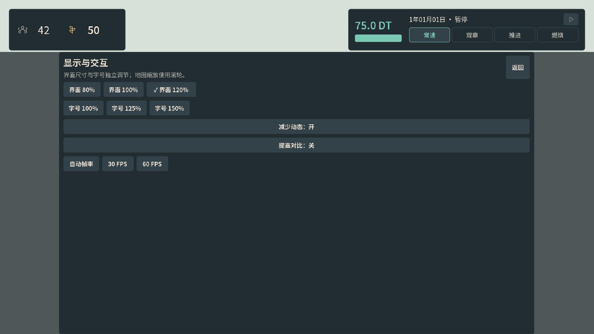

# Beta.2 设置入口修复 — 2026-10-05

此前左下角齿轮的原生点击失败：鼠标按下时获得焦点，焦点回调请求排版；`layout_ui()` 将齿轮短暂隐藏再显示，取消了尚未释放的按钮点击。修复前原生探针确认鼠标悬停命中齿轮，但 `pressed` 回调为 0，设置弹窗没有打开。原建设影响验收直接调用 `display_options()`，因此其通过结果未覆盖这个入口。

修复只移除排版过程对齿轮的临时隐藏，保留其父工具栏在弹窗、档案、投标和欣赏模式下的显隐规则。未修改模拟器、玩法或存档。

回归现在从玩家使用的齿轮入口进入「河谷手册与存档」，再点击「显示设置」。每次先移开焦点，按下鼠标后经过真实帧排版再释放，验证恰好一次 `pressed` 回调和实际弹窗标题；覆盖 UI 80%／100%／120% 下关闭、重新进入与缩放，确认地图尺寸和城市完整状态保持不变。

Godot 4.7.2、X11/Xvfb、Mesa llvmpipe GL Compatibility 下，始终固定 **1920×1080 全屏**。更新后的完整建设影响界面套件 **1073／1073 通过**，执行 102 次原生输入、生成 9 张新截图。验收前后产品源码与资源未变，指纹为 `df2e783ac2b455e7a2b799b67ae4707bb2eb347386d4298ad119ca64048fee0f`。本轮没有修改 core；未重新执行此前 401 项核心套件与 977 项另一套 UI 回归，旧结果仍属于旧验收。

原始报告、入口修复前后日志、源码哈希以及本次设置截图见 [settings_fix_evidence](settings_fix_evidence/)。其余 8 张本次套件截图保存在隔离的本地验收目录，JSON 记录其准确路径；没有用旧截图替代本次结果。独立源码审查未发现阻塞问题。

这是 Linux 原生自动交互，不能证明 Mac 原生启动、Apple 签名接受或目标 GPU 性能。新 macOS 包的源码提交、校验与包内入口验证另见 [交付记录](MACOS_DELIVERY.md)。
