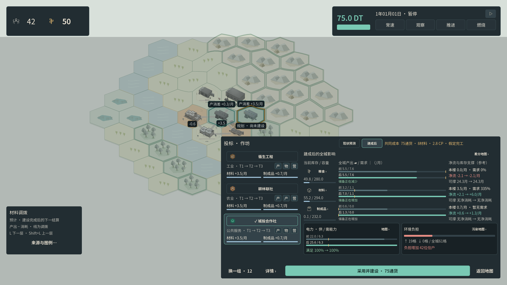
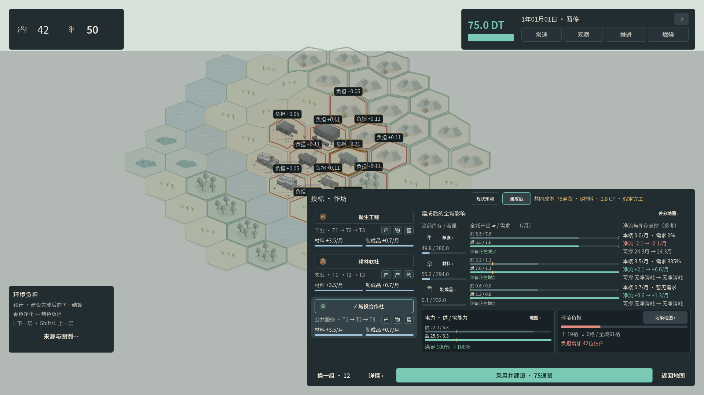

# Beta.2 建设影响与 UI 缩放验收

本轮继续 Godot 主线，将建设比较从长文平铺改为资源供需与城市影响图形，并加入整体 UI 缩放和图层快捷键。现有 Unity Hero Valley 源码切片仍独立；本报告没有 Unity 运行结论。

## 实现与口径

- 显示设置提供 UI 80%／100%／120%，只缩放统一界面父节点；地图大小、滚轮缩放、世界坐标与摄影独立。字号仍有 100%／125%／150%。
- 三家运营者显示真实名称、成长槽轨和最多两个候选指标。选择读取同版本预测缓存，不付费、不重抽；唯一确认按钮留在固定底部，过期预测先刷新并返回。
- 粮食／材料／制成品显示当前全城库存及当前容量、同轴建设前后供给／请求需求、真实净流、本楼产出占预计需求的比例，以及按当前库存估算的支撑月数。月率来自实际结算回执；零需求时比例不可用。全城总库存不保证局部可达，支撑月数也不是经营保证。
- 电力显示全城供／需能力和真实满足率，不作为库存或每月累积量。环境图以全城地格为分母，标出负担增加／减少的格数与现有住户；原始场强与受体读取方式可查，不把住户暴露增加称为健康损失。
- 地图可切换未建设的下一结算与假定建成的同一结算，并明确标记预测来源。资源、电力、污染及差分均有直接入口；`L`／`Shift+L` 循环图层，输入框／弹窗／档案持有输入时阻止切换。
- 差分分别表达供给／服务与消耗／竞争／环境负担，斜纹表示并存，不把不同单位相加。地图资源标签为产消差；全城净流另包含贸易、损耗及交付。正常城市几何仍来自当前城市，仅显示未购买的规划幻影。

## 本轮实际验证

引擎为 Godot **4.7.2 Standard**。原生画面由 X11／Xvfb、Mesa llvmpipe GL Compatibility 生成。始终是 **1920×1080 全屏**，只改变界面和字号比例；没有测试不同窗口、其他分辨率或移动端。

`tools/test_beta.sh`：**401 项核心检查及 6／6 经营路线通过**，其中预测回归 43／43。新增原生建设影响套件：**1040／1040，通过 94 次原生输入操作，生成 8 张新截图**。套件独立克隆真实 Game 并运行 Simulation，核对同一步两侧回执、当前库存、净消耗、全城电力和逐格环境场。选择、缩放、滚动与地图操作保持玩家状态、RNG、编译规则和 revision 不变；所有 Button 点击另核对实际 `pressed` 回调，而不是仅检查相同选择值。

原有完整界面回归同一源码下 **977／977，通过 154 次原生输入操作，生成 57 张截图**，涵盖 L0／L2／档案、政策、奖励、安装、市场、地图命中与命令失败反馈，受测源码指纹同样未改变。原始 JSON／日志／验证摘要另以 `ui-reset-*` 保存；57 张回归截图留在本轮隔离证据目录，不用旧图替代本轮建设影响截图。

100% 字号下，UI 80%／100%／120% 的全部资源、电力、环境、候选及确认按钮通过实际 ScrollContainer 裁剪检查，核心影响不需要先滚动。125%／150% 字号保留可用的选择与固定确认动作，原生滚轮能够查看完整内容。整体 UI 和字号变更均不改变地图大小、缩放或地格屏幕坐标。

原始报告、输入、布局矩形、源码前后哈希与截图保存在 [ui_impacts_evidence](ui_impacts_evidence/)。此次实测源码指纹：`44474ec3dd5fe5f106ec01c35fd2cdae1a8dd714f9dda478d39f5d8ea0f96b7a`；验收期间列出的产品源码／资源／测试文件未改变。报告中的基础提交与当时未提交状态保留原样，不能把基础提交单独当作此次修改后的源码。

## 验证边界

这是显式城市夹具和原生自动交互，不是真人试玩或自然经营结果。Linux 软件绘制不证明目标 Mac GPU 帧率、macOS 原生启动、Apple 签名接受或公证；本轮也没有新增性能承诺。macOS 包按 [交付流程](MACOS_DELIVERY.md)独立导出和校验，实际包的准确源码提交／校验值由随包验证记录给出。
