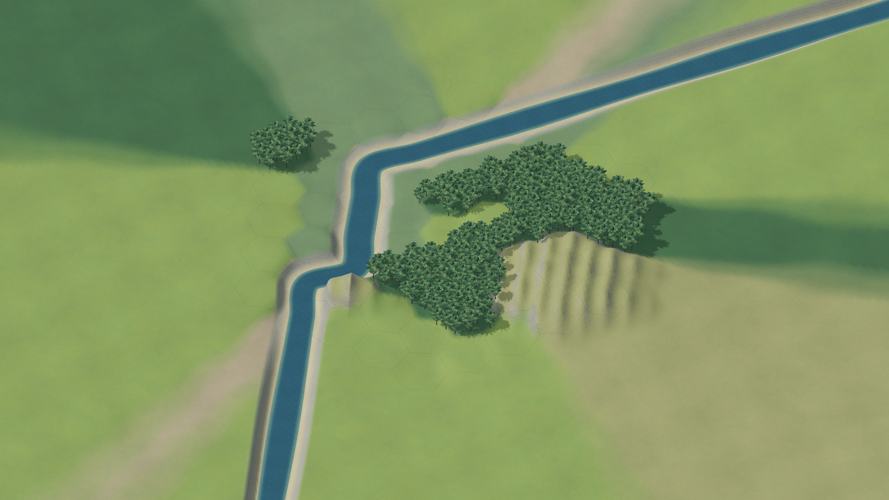
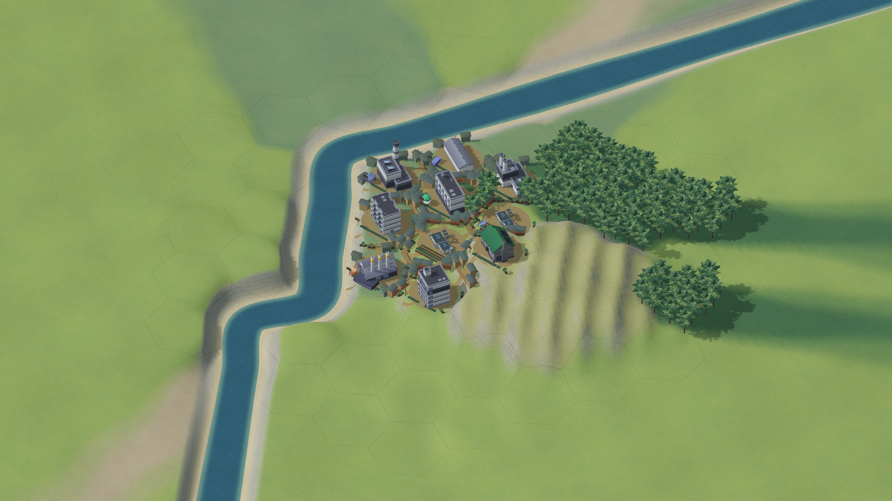

# City 发展弧：本轮本地验收

日期：2026-10-14。接续标识：MET-CITY-ARC-20261013-01。

应用版本 **0.6.0-city-arc.1-local**；源码为当前 `codex/met-beta-v3` 工作目录在 `72aee5b` 上的未提交修改。本轮完成本地开发、实际 Unity 构建和 Mac Player 验证，不推送、不发布、不合并、不部署，也不自动启动下一轮。原 Godot 游戏和既有发布保留。

## 已接通的玩家链路

| 主轴 | 当前实现与入口 | 本轮证据及边界 |
| --- | --- | --- |
| 永久 City / District / Block | 城市档案中新增地区、扩展街区和切换视图；旧地区保留人口、资产和运行状态 | 实际命令达到两地区四街区；整城保存、导出、回读；非授权区域可查看且不能直接施工 |
| 有成本的扩展与依赖 | 选择真实旧街区作为启动来源，扣实际通货和库存；既有能力、制度改变后续成本 | 三次后续启动均留下真实来源与扣款；初始 charter 不重复赠送 |
| 双时间与区域物流 | 共享有限外部市场、节点运力、跨区货物、在途缓冲和运费；Local 加速只作用于授权焦点 | 102 项经济检查及完整链实际交付；所有地区在原生常速运行中推进；自治奖励不会冻结经济 |
| 治理与接续 | 实际粮食、服务、财政、污染影响支持与授权；稳定承诺、主动交班、危机、自治、付费回任 | 完整链实际发生交班、三次粮食危机及回任，资产保留；治理专项 39 项检查 |
| 分层遗产与制度 | Local 留在原处，Portable 转移真实未使用许可，地区制度及城市能力有来源 | 专项验证许可守恒、来源与后续启动差异；不是复制旧库存或全部搬迁 |
| 身份与世界史 | 实际人口、产业、地理布局、制度及任期派生身份；永久历史 ID 与保存游标 | 刷新、预览、回读不重播奖励、不消费 RNG、不改变经济；原生遗产与城史入口检查 |
| 科研、高级工业与托卡马克之冠 | 运行教育产生知识，研究实际消耗投资；制造以真实投入生产独立高级部件；多地区交付、共享施工能力 | 无资格/材料注入的 27 项完整链验证；真实消费材料 120、高级部件 30、施工 96 CP，完成后同城继续 |
| 原有核心及 UI | 保留建筑专业化、运营者/槽轨、升级、主题、委托、奖励队列与来源信息；增加六个城市页 | 核心 174 项、完整状态对照 88 个检查点、最终 Mac 原生 201 项通过；自动控件回调不等同真人鼠标试玩 |
| Life 接口 | 独立 Wild；现实桥接的版本、确认、去重、更正责任见 LIFE_INTERFACE.md | 仅接口文档；本轮没有连接现实项目、账户或真实记录 |

## 真实能力链

[纯 C# 完整链摘要](evidence/core-journey-summary.json)来自 `CityArcWalkthrough.Execute`。它使用真实招标、建造、升级、领取可操作地区的奖励、市场订单、区域物流及治理命令，没有直接注入研究资格、高级部件、工程库存或完成状态。首次 Mac Player 在其纯核心 worker 中重新执行完整链，耗时约 **383.49 秒**，817 次 Advance、4,241 个提交切片，27 项检查通过。

三项技术累计实际消耗知识 12、通货 245、材料 31；高级工业累计制造约 44.133 单位部件，实际消耗材料约 88.267、制成品约 44.133、通货约 132.400、剩余供电约 88.267。托卡马克获得两地区的真实材料/部件交付和四街区的施工贡献，没有把同一 CP 同时用于本地队列和城市工程。自治地区的两街区保留共 3 份未领取奖励，非焦点活跃街区另有 8 份；奖励保留和继续经营都已验证。

该链提交约 17 来生年的正常逻辑时间，不是持续 17 年的人类游玩，也不证明有限 DT 加速策略、外部等待时长和数值节奏已好玩。治理专项中为分支覆盖直接设置资金、许可或短缺的 fixture，与这条无资格注入链分开记录。

## 原生构建与最终运行

Unity **6000.6.5f1** 实际完成 C# 编译、资源导入、URP 场景和 macOS 通用 Player 构建。最终运行设备为 **Apple M5 Max / Metal**，全屏渲染 **1920×1080**，限帧 **60 FPS**，所有测试使用隔离存档目录，正式玩家存档未参与。

[最终原生报告](evidence/native-final.json)的 **201/201** 检查通过、运行错误为零，覆盖起源、原有管理页、城市六页、地图及预测的只读、区域权限、实际命令入口、新城后清除旧供给来源、完整保存/导出/载入、四街区实际运行和截图。[首次原生报告](evidence/native-first-pass.json)记录从头执行的完整能力链。最终 Runtime 性能复测明确复用了那次 Player 通过真实命令产生的整城；报告 `city_arc_actual_command_journey` 中的 `reused_prior_native_earned_world=true` 表明没有在最终构建中再次执行 383 秒的整条链。

最后的 `tools/test_unity_city.sh native` 命令正常退出，退出码 0。首次原生进程本身验收成功后，外层脚本曾因本轮新增的 case 分支语法问题退出 2；脚本已修复并在最终运行中验证，不把首次包装命令称为成功。核心最新独立回归见[日志](evidence/core-regression-and-parity.log)：174 项通过、88 个完整状态检查点匹配；本轮对照使用已有、匹配当前地理版本的 Godot 导出夹具，没有重新运行 Godot 引擎。

## 占用、卡顿和地貌

| 实际 Mac 采样场景 | 帧间隔中位数 | p95 帧间隔 | 进程 CPU（一个核心为 100%） | RSS |
| --- | ---: | ---: | ---: | ---: |
| 首次四街区常速，同步主线程推进 | 见原报告 | 182.50 ms | 69.02% | 858.48 MiB |
| 四街区常速，最终每秒提交的独占 worker | 16.67 ms | **17.64 ms** | **69.93%** | **878.09 MiB** |
| 最终三建筑暂停场景 | 16.67 ms | 17.57 ms | 26.75% | 497.17 MiB |

四街区性能采样为当前真实挣得的整城、正常 1:1 时钟、应用处于前台，300 帧。它说明本轮可复现的主线程长卡顿得到修复；RSS 没有降低，短采样也不证明长期大城或所有加速档的性能。[修复前报告](evidence/active-before-worker.json)、[最终报告](evidence/active-final.json)分别保留。上述数值是 renderer 帧间隔与进程 CPU/RSS，不是 GPU 单项计时。

改变包括：单个 worker 独占模拟，界面和地图读取已提交的脱离快照；命令、保存和生命周期先收口 worker；等待 worker 前封存活跃时长，避免等待时间额外消耗 DT；Hex 缓存改为线程独立。Astra 独立复核的 350 ms 等待复现与 100 轮、744,200 次距离核对通过，最新核心回归通过。实际操作系统从加速状态失焦再恢复的人工确认仍未完成；当前自动化输入无法可靠操作 Unity 全屏按钮，不能把代码/替身测试冒称该项通过。

货运改成 **60 External 秒**的固定到货批次，收集增加的等待不超过 60 秒；永久累计成交与准确当次收据分别保存，避免聚合后主题/委托丢失或重复消费。独立纯 Core 一小时半秒切片复测中，在途行数从 7,200 降至 60，整城 JSON 从 2,016,742 降至 173,700 字符，温态推进从 26.69–43.54 ms 降至 5.10–7.21 ms。这是 CPU 模拟证据，与上述原生帧率分开。

地表新增按世界坐标逐像素生成的草土细节、尺度过滤、岩坡层理、微表面及河面细流光；山脊减少圆鼓包感，树木按相同材质合批。保留种子生成的连续地理、真实状态驱动的邻格肌理与局部更新。新图是原创参数化材质，不是新的图像模型贴图流水线。以下图均由本轮 Unity Player 输出；成长图有明确注入的脱离视觉夹具，不能称为真人建设过程。





**美术尚未达到 Civ6 的质感，也没有得到用户实看认可。** 树种/建筑外形的丰富度、地貌轮廓和生态过渡的细腻程度仍有限；本轮完成的是具体材质、形态与性能修复，不能把“运行通过”当作这项美术目标完成。

## 本地交付与复现

应用：`build/MET City Arc Local.app`。归档：`build/MET-City-Arc-0.6.0-local-macOS-universal.zip`，从最终运行通过的通用 app 重新生成。ZIP 经实际解压、可执行权限与 Unicode 文件名检查，并对解压 app 执行 `codesign --verify --deep --strict`。采用 ad-hoc 签名，没有 Developer ID 或 Apple 公证。通用二进制包含 Intel 与 Apple Silicon；本轮仅在 Apple Silicon 实机运行。

整城独立保存为 `met_city_v1.json`；旧 Unity 单街区及 Godot 文件保持独立，不承诺互导。正常载入会暂停并记录离开时长，不补生产、市场、DT 或奖励。

复现入口（仓库根目录）：

```bash
bash tools/test_unity_city.sh city-core
bash tools/test_unity_city.sh core
bash tools/test_unity_city.sh editor
MET_UNITY_MAC_OUTPUT="$PWD/build/MET City Arc Local.app" bash tools/test_unity_city.sh mac
MET_UNITY_MAC_OUTPUT="$PWD/build/MET City Arc Local.app" bash tools/test_unity_city.sh native
```

`core` 命令会重新生成 Godot 对照，与本轮复用夹具的独立审查有所不同。引擎与性能进程应串行执行。最终快速原生复测可显式指定 `MET_CITY_ARC_JOURNEY_REPORT` 为先前完整链 JSON；未指定时从头执行能力链。候选数值与责任见 [SESSION.md](SESSION.md)、[CONTRACT.md](CONTRACT.md) 和 [LIFE_INTERFACE.md](LIFE_INTERFACE.md)。
