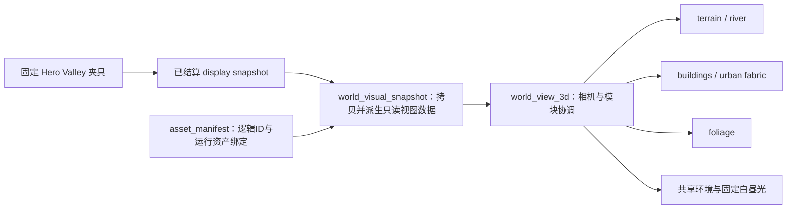

# Living World3D V0–V1 架构、审计与迁移建议

本文定义独立的 Living World3D 视觉轴及其演进边界。它复用 MET 的游戏状态与现有世界资料，但作为可选展示路径开发；不替换当前 2D 游戏、不改变默认渲染器，也不把一次视觉切片扩成完整美术重制。

设计合同与代码审计记录在一起，便于后续逐项核对。本文不是验收报告。截图、实际运行结果和性能观察由 [Living World3D V1 验收记录](ACCEPTANCE.md)记录，并由主任务的验收整理补写。不要把架构目标当成已验收结果。

## 范围与不变量

- **V0：分离数据与视图。** 2D 游戏状态经由已结算快照转换为独立的视觉数据，再交给 3D renderer。渲染器可读这些副本，不得写回游戏状态、改变 RNG、经济、建筑或实体。
- **V1：固定 Hero Valley 切片。** 使用固定种子的 **37 Hex 河谷**、**4 个建筑实例**、一套河谷树木原型和贯穿场景的河道；作为一张稳定的纵切场景，用于视觉与技术验收。注册的建筑原型为农居、邻里中心、作坊和住宅 T2；注册的树木原型为 `nature.tree.valley_01`。树种数量与场景中的实例数量是不同概念，实例位置由视觉种子稳定生成。
- **统一照明。** 所有运行资产接受同一套固定白昼方向光和 WorldEnvironment。固定白昼是表现参数，不是天气或时间模拟；建筑资产不自带灯光或烘焙场景光。
- **默认路径保持 2D。** `project.godot` 的默认渲染器仍为 GL Compatibility。只有带显式命令行参数启动时才进入 Hero Valley；正常开游戏、读档与 Beta 工作流继续使用现有 2D 路径。
- **只读与局部交互。** 3D 视图仅允许观察、镜头控制和 tile hover/select 信号。它不提供建造、升级、资源、存档或时间操作。
- **阶段边界。** 此切片不承诺覆盖完整建筑库，不加入昼夜/天气玩法，不进行移动端开发、适配、打包或设备验收，也不自动发布到 GitHub。

## 启动方式

仓库根目录下设置 Godot 4.7.2 Standard 可执行文件。正常启动仍使用原来的 2D 主场景：

```bash
"$GODOT" --path .
```

在支持 Vulkan 的桌面环境中，显式以 Forward+ 打开固定 Hero Valley：

```bash
"$GODOT" --path . --rendering-method forward_plus --rendering-driver vulkan -- --hero-valley
```

`--hero-2d` 只打开同一固定夹具的 2D 基线，用于分开检查 2D 与 3D 显示：

```bash
"$GODOT" --path . -- --hero-2d
```

`--rendering-method` 和 `--rendering-driver` 是当前进程参数，不改写项目默认值。`--` 之后的 `--hero-valley` / `--hero-2d` 是项目参数。此云环境的 Vulkan Forward+ 使用软件 Vulkan / lavapipe；该环境可用于功能路径观察，不能代表硬件 GPU 性能结果。开始新会话时仍应记录实际 Godot 版本、renderer、driver 和设备。

## 数据流与模块职责



| 边界 | 入口或模块 | 职责与约束 |
| --- | --- | --- |
| 夹具与启动 | `ui/app.gd`、`ui/world3d/hero_scene.gd`、`tests/fixtures/hero_valley.gd` | 仅在显式参数下生成固定场景；不读取或替换玩家存档。夹具使用真实游戏规则形成已结算状态，再交给视图适配层。 |
| 只读视图模型 | `ui/world3d/world_visual_snapshot.gd` | 要求 `source_phase=committed_tick` 且非 forecast；复制展示字段与定义，再派生高程、foundation、fabric、河道路径和边界。下游不持有可用于改写游戏的接口。 |
| 场景协调 | `ui/world3d/world_view_3d.gd` | 接收 snapshot，组合各 renderer、共享环境和调试覆盖层；管理相机、缩放、平移及 tile 命中。仅向外发只读 hover/select 信号。 |
| 地貌与水系 | `terrain/terrain_builder.gd`、`terrain/river_builder.gd` | 从同一份派生地形与河道中心线建立连续地表和连续河道。Hex 是场景数据和命中单位；分析网格由独立 debug overlay 显示，不要求把每格做成有缝的独立渲染面。 |
| 城市形体 | `city/building_renderer.gd`、`city/fabric_renderer.gd` | 依 `definition_id → logical asset ID → runtime path` 查找建筑；由已结算项目、foundation 与 connector/filler 关系生成建筑、街巷及小型填充物。任何装饰物都不是 Gameplay Entity。 |
| 植被 | `foliage/foliage_scatter.gd` | 从同一种原生树木原型生成稳定的视觉实例；用世界种子与视觉种子定位，并避开河道、场地、道路和陡坡。它不创建居民、资源或游戏对象。 |
| 光照与环境 | `environment/environment_controller.gd`、`environment/environment_state.gd` | 场景中只有一份共享 DirectionalLight3D 和 WorldEnvironment；V1 固定白昼状态提供光照色、方向及固定环境值，不读取玩家日历或天气。 |
| 分析层 | `debug/visual_debug.gd` | 可选显示逻辑 Hex 与 hover 高亮，作为检视工具，不作为新增玩法或默认美术覆盖。 |

固定夹具由游戏状态创建一次并暂停，3D renderer 只看到已提交展示数据。snapshot 是明确的数据边界：若未来要让视图随真实城市刷新，应由现有应用层在提交后生成新 snapshot，再整体替换视图输入；不要把 Game、Simulation 或保存对象传给 renderer。

## 资产、尺度与许可

运行 3D 资产由现有参数化 MET 构造器导出。四种建筑和一种原生树木都在 `content/presentation3d/asset_manifest.json` 中登记；每项关联可编辑源 `.blend`、GLB、generator 与依赖哈希、逻辑 ID、定义绑定、bounds、footprint、pivot、尺度和许可证口径。细节以 [资产导出登记](ASSET_EXPORT.json) 与 [资产来源说明](ASSET_PROVENANCE.md) 为准，不另在脚本中维护第二套事实。

当前登记使用 `LicenseRef-MET-Project-Original`。这是随获授权的 MET 源码仓库与游戏运行资产交付的项目原始作品标记，**不是 CC0，也没有授予外部任意复用权**。`attribution_required: false` 只表示当前没有第三方署名义务。新增素材必须先确认 source 与 runtime 的再分发权，并登记原许可和哈希；“可商用”本身不足以允许放进源码仓库。

导出器负责 Blender → Godot/glTF 坐标转换和统一尺度烘焙；manifest 是 runtime 绑定、ground pivot 和真实 bounds 的唯一登记入口。建筑定位、foundation 平台、footprint、river/terrain 与街巷连接必须一起符合这一坐标合同。不要靠每个 renderer 的临时 scale、偏移或 rounding 来补偿错误；改变导出尺度或 pivot 时，同步导出资产、manifest、provenance 与几何验收数据，并保留 2D legacy catalog 的原意。

旧的 2D catalog 与已交付 Beta 视觉不因新资产而删除、重命名或改写。新资产只属于独立 3D 运行目录，3D 未覆盖的逻辑 ID 应明确进入缺失清单，不能静默借用不匹配的模型。

## 审计结论与待验收项

仓库结构已经把 3D 入口、snapshot、地貌/河道、建筑/街巷、树木实例、共享环境、资产 manifest 和源场景分开。`project.godot` 默认仍选择 `gl_compatibility`；Hero Valley 入口要求 Forward+，默认城市路径无需这项 renderer 覆写。新 provenance 明确限定项目原始资产的分发口径。

下面这些目标的状态和证据由验收记录管理；本架构文档只列出核对门槛，不预写通过或失败结论：

- 固定 seed 在每次启动得到 37 个 Hex、目标河谷河道、4 个建筑实例，以及登记树种的稳定位置。
- 建筑 ground contact、footprint、pivot、尺度与平台边缘一致；河岸与连续地表相接，没有可见穿插或断缝。
- 整个场景共享统一白昼光，材质没有各自携带的方向光或场景烘焙。
- 视图构建、交互和 renderer 覆写的结果符合验收记录要求；现有 2D 默认启动、存档与测试入口仍保持原路径。
- 对 Forward+、Vulkan driver 和设备信息分别记录；软件 Vulkan 与硬件 GPU 结果不能合并宣称。

执行结论、截图、JSON 证据、测试状态与任何性能读数统一放进 [Living World3D V1 验收记录](ACCEPTANCE.md)。不要在该报告运行前预写通过结论、截图验收或真实性能数字。

## 迁移方案

1. **封住 V0 边界。** 维持显式启动参数、独立夹具和 detached snapshot；确保 renderer 不依赖玩家存档或模拟写接口。每次视觉修正先核对逻辑 ID、transform 与 manifest provenance。
2. **完成 V1 验收。** 固定 37 Hex / 4 建筑 / 树种 / 河谷配置、统一灯光、地表/河道连接与视图只读约束，全部先进入 ACCEPTANCE 并由实际证据关闭。失败项留为明确缺口，不改写原 Beta 的通过标准。
3. **逐类扩充 registry。** 若 V1 后决定覆盖真实城市，按稳定 `definition_id` 分批加入模型、fallback 和 bounds；每批检查绑定唯一性、缺失资产报告、空间占用、实例总量和版本化哈希。保持模拟定义与 asset ID 分开，以免重命名美术文件迁移存档。
4. **在应用层接入已提交更新。** 只有独立授权接入实时城市后，应用层才可在提交点生成 snapshot；renderer 仍是纯展示端，不持久化视觉状态。快照签名未变化时不重建，签名变化时可整包替换并记录 build 数据。
5. **最后评估默认呈现。** 只有当完整建筑覆盖、验收证据、目标硬件验证和明确产品决定都具备后，才评估默认路径或更广泛替换。项目默认 GL 2D 在此决定之前持续有效；不根据软件渲染容器的单次结果切换默认设置。

## 下一阶段建议

当前阶段的下一步是完成 V1 视觉合同与证据记录，然后冻结 Hero Valley fixture、manifest 与截图条件，减少场景输入漂移。先解决边界接触、river/terrain 连续性、建筑真实 bounds/pivot 和共享光照的一致性；视觉缺口应回到对应模块或 exporter，而不是在 renderer 堆临时补偿。

验收关闭后，建议优先做可追踪的资产覆盖表和批量导入/缺失告警，再考虑把这条只读渲染路径接入更多模拟场景。不要因为模型数量扩张而先做完整天气、动态昼夜、mobile renderer、District 城市或整套新 art direction；这些都超出本轮独立视觉轴。
