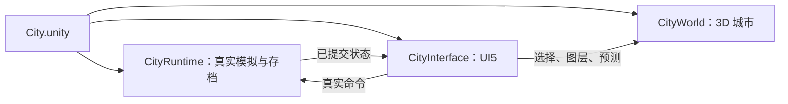

# UI5 真实游戏接入与整体视觉复核

2026-10-18。本轮结论：**UI5 已接在真实 Unity 主游戏中，独立包只是另命名构建与隔离存档的交付形式。整体 UI 美术与易读性尚未完成。** 没有把 HTML 原型当作主游戏，也没有把流程测试通过等同于整体完成。

## 仓库和默认入口

- 仓库：`/Users/lizhirui/Developer/MET_0.3.2_Source`。
- 当前分支：`codex/met-beta-v3`；基准提交 `72aee5bcbf2f80d78823f76ff21ba66e59f375b8`，其上保留已有未提交改动。本轮没有提交、合并、推送或发布。
- 实际工程：`unity/METLivingWorld`，Unity `6000.6.5f1`。
- 默认构建场景：`Assets/Scenes/City.unity`。`EditorBuildSettings.asset` 启用该场景；`CityProject.BuildMac` 也明确构建它。
- 场景根 `MET_Laisheng_City` 挂载 `CityRuntime`、`CityInterface`、`CityWorld` 和 `CityBootstrap`。
- `CityInterface.Awake → BuildShell → BuildPlanningHud` 是普通启动路径，没有 UI5 开关。`CityBootstrap.Start` 将界面连接到真实模拟快照、建筑选择、地图图层与对比预览。`CityEvidence` 只在显式诊断参数下添加。

源码入口在 `Assets/City/UI/CityInterface.cs`、`CityHud.cs`、`CityGuidance.cs`、`CityPages.cs`、`CityMilestones.cs`、`CityConstructionDecision.cs`、`CityBlueprintDesk.cs`。这不是另起的一套模拟器。

从源码进入当前游戏：用 Unity 6000.6.5f1 打开 `unity/METLivingWorld`，打开 `Assets/Scenes/City.unity` 后运行。通过 `MET → City → Build macOS universal app` 或现有 `CityProject.BuildMac` 构建的也是这个入口。旧 `project.godot` 和 `HeroValley.unity` 属于保留的历史路径，不会加载 C# UI5；本轮没有替换这些历史入口，也没有覆盖已有正式应用包。

## 同一交付应用的普通启动证据

已交付版本 `0.7.0-ui.5-local`，ZIP SHA256：`a35683ea4ac161b03c5359c0414b3bec39e2148a1c789d2e2f52e7ec801cc666`。

本轮直接运行此前交付且校验一致的应用文件。参数只有 `-batchmode` 与 `-logFile`，没有 `--validate-ui5-headless`、流程测试、观察器或场景替换参数。唯一隔离项是 `MET_UNITY_SAVE_ROOT`，避免写玩家存档。

| 正常启动场景 | 实际结果 |
|---|---|
| 空存档目录 | 进入 `choose_district`，0 个街区，暂停；观察到真实 Runtime 自动保存。 |
| 随包城市检查点副本 | 进入 `play`，恢复同一城市与街区，暂停；项目、地格、RNG、货币、DT、蓝图实例、模拟 tick、Local Time 与指标保持一致。 |

两次都是观察正常自动保存后终止本次测试子进程，退出码均为 0，没有记录到运行错误。**26 项启动与来源检查通过。** 这证明无界面下的普通启动与读档路径，不证明桌面窗口、系统输入或性能。

本机证据根：`/Users/lizhirui/Documents/Codex/2026-10-14/task-6/strategy-ui5/`。

- `integration-evidence/integration-startup-report.json`：启动参数、分支/提交、26 项检查、两次运行结果。
- `integration-evidence/new_profile/`、`existing_city/`：原始 Player 日志及观察到的启动状态。
- `integration-evidence/source-manifest.json`：运行时核对的源码哈希。
- 原交付应用与源码快照仍在 `runtime-headless/` 和 `delivery/MET Strategy HUD UI5/` 对应记录中。

## 修正离屏采集遗漏

整体对照发现旧离屏图缺少树林。原因是协程截图在 `LateUpdate` 前手动提交摄像机请求，而 `CityFoliage` 的实例化植被正是在 `LateUpdate` 逐帧提交；旧图因此遗漏树木、灌木与岩石的瞬时绘制。

仅修正 `CityEvidence.Ui5.cs` 的诊断采集时机：手动世界/肖像渲染前调用现有植被绘制方法。没有改植被分布、模型、材质、普通绘制路径或模拟状态。修正后成熟城市画面显示原有树林，诊断记录为 114 棵树、19 个地表细节实例。

`runtime-complete-world/` 的新一轮 **472/472 检查通过，0 errors，23 张图**。这些仍为实际 Unity 世界与 uGUI 的离屏合成，不能称为桌面截图。`production-source-parity.json` 确认：与原交付源码相比，33 份跟踪 C# 文件只有诊断采集器改变，生产 UI 源码一致。原应用 ZIP 未被替换；新图纠正的是证据采集遗漏。

## 整体视觉尚未完成的部分

对照的是用户批准的《群星》式 MET 概念图 `libfile_25717c339e688191a18ed99c487e2ffe`，不是宣称已复制商业游戏的全部界面。顶栏资源/许可/任务/里程碑、左下建设和右下时间遵循后续布局要求；保留 3D 沙盘、暗色薄边面板和克制的青色强调。

1. **概况与里程碑仍像长文档。** 暂停说明和重复摘要占据首屏，城市用途分组与多个阶段要滚动才看到；城市/经营两层命名仍易混淆。
2. **任务和 Bonus 选择仍有阅读负担。** 规则、条件与收益混排，`R17`、`P09` 等内部标识应退入来源；安装预览需要持续显示建筑身份，并区分局部/全城效果和负面代价。
3. **默认字号、图标与插画不够统一。** 100% 下部分标签太小，许可比相邻导航更重；线稿、微型示意图和实景肖像的风格与尺度不一致。
4. **侧面板材质与选中反馈仍需细化。** 部分区域过于平直或透明，建筑肖像周边信息过多；地图选择强调弱于参考。
5. **下一步已清楚，但状态摘要仍可收紧。** 左侧通用决策通知与右侧内容重复；必须处理决定时，时间按钮仍写“继续”，应让措辞更准确地预告将打开决定页。

独立 Astra 复核见 `INTEGRATION-VISUAL-AUDIT.md`。前轮关闭的是遮挡、串页提示和换行等阻塞缺陷，不能把那个结论扩展为整个界面完成。

## 回滚与待验收边界

UI5 代码增量保留于 `SOURCE-CHANGES.patch`，上轮用户工作区基线在 `baseline/`、`baseline-manifest.json`。同步脚本遇到当前文件哈希与已记录版本不符会拒绝覆盖。`rollback_ui5.py` 默认只检查并列出回滚计划；只有显式 `--apply` 才恢复 UI5 前的局部源码，先核对全部目标，避免覆盖后续用户修改。本轮未执行回滚。

本轮新增的说明只补充当前 Unity 入口，根目录和 Unity README 的原文已另存于 `integration-evidence/document-backup/`，没有清理其他未提交文件。真实全屏鼠标命中、键盘/焦点/Esc、悬停延时、地图拾取和性能实测继续等待，不占用户前台。插画精细度和上述整页重排属于未完成项，没有用程序检查数量代替视觉与使用验收。
