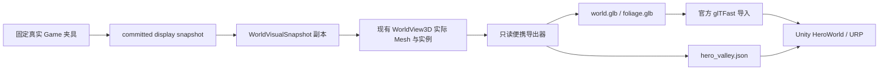

# Unity Hero Valley 移植架构

本轮把现有 Living World V1 河谷可视切片移到一个独立 Unity 项目，建立可比较的导入、观察、验证与构建入口。城市模拟、玩法 UI 与存档仍由当前 Godot 游戏负责。Unity 工程没有另一套 Game、经济或城市成长实现；它读取一份固定的已结算展示数据，用于评估 Unity 是否能改善 MET 的视觉制作效率。

实际验收范围见 [ACCEPTANCE.md](ACCEPTANCE.md)。Unity 源码与配置已提供，但当前没有已激活的 Unity 编辑器；不能把 Godot 导出成功当成 Unity 已运行。

## 原实现审计与复用

既有 [Living World3D 架构](../living_world/ARCHITECTURE.md)继续有效。`tests/fixtures/hero_valley.gd` 用真实 Game 建立固定种子河谷，完成一次真实结算后暂停；`world_visual_snapshot.gd` 拒绝 forecast，并把展示字段、建筑定义与资产 registry 复制为独立视图数据。`world_view_3d.gd` 已生成连续地形、河流、foundation、建筑、道路及六个树木 MultiMesh 批次。

新桥接器 `tools/export_unity_hero.gd` 调用这些实现，复制实际生成的 Mesh 与 Transform，由 **Godot 内置 GLTFDocument** 导出。它不重新计算一套 Unity 河谷，不手写 glTF 文件，不修改既有 core、2D renderer 或 Living World renderer。已有四栋建筑和一种树木直接复用；本轮没有重新建模，也没有下载素材包。

## 单向数据流



GLB 和 sidecar 不包含完整 Gameplay 状态。Unity 不获得钱包、库存、居民群组、Rule、Simulation 或可写存档接口。导出器在开始与结束时记录完整 `Store.encode(game.s)`、RNG、wallet、compiled 和 revision 的摘要，同时检查 detached snapshot 的摘要不变；这些证明只记录哈希，不能还原或修改玩家城市。

Unity 工程中的职责已写成独立模块，以下是源码职责，运行结果仍须在授权环境中验证：

| 模块 | 当前职责 |
| --- | --- |
| `HeroContract.cs` | JSON DTO、schema/committed provenance 校验，以及 RH 数据转换；没有 Gameplay API |
| `HeroWorld.cs` | 加载 `Hero/hero_valley` 与 glTFast 导入预制体，组合几何、共享相机/光照、tree renderer 和只读命中层 |
| `HeroFoliageRenderer.cs` | 合成共享树原型、保留六个材质/submesh，通过 `Graphics.DrawMeshInstanced` 绘制 29 个 placement；没有每树 GameObject |
| `HeroCameraController.cs` | 平滑平移/缩放、固定摄影与重置；改变相机不重建导出数据 |
| `HeroInteraction.cs` | 地形/platform collider 命中、只读 Hex hover/select 与分析线；不提供建造或时间操作 |
| `HeroValidation.cs` | 检查契约、实际导入几何、triangle、材料、落地与数据摘要 |
| `HeroEvidence.cs` | 授权环境运行后输出验证 JSON、固定截图或 renderer 测量；当前尚未实际产出这些 Unity 证据 |
| `Editor/HeroProject.cs` | 通过官方 API 建立 URP 与场景，同步导入、Editor 校验以及 macOS universal 构建入口 |

配置代码使用 Linear color space、1920×1080 全屏、HDR、4× MSAA、40 世界单位的阴影距离、两层 cascade 和 ACES；质量级别共享同一 URP 资产。相机/环境由一处协调，不由地形或树各自读取时钟。层 8 的 MeshCollider 只用于实际地形和建筑平台命中；水体和装饰不成为 Gameplay 对象。

## 免费组件与资产许可

Unity 项目位于 `unity/METLivingWorld/`，配置目标为 **Unity 6000.0.58f2**。以下是 `Packages/manifest.json` 声明的官方组件版本；尚未由已激活编辑器完成包解析与导入：

| 组件 | 配置版本 | 本轮用途 |
| --- | --- | --- |
| Universal Render Pipeline | `com.unity.render-pipelines.universal@17.0.3` | 现成实时 PBR、方向光、阴影与后处理基础 |
| Unity glTFast | `com.unity.cloud.gltfast@6.20.0` | 官方 GLB 导入与材质接线，避免自写模型解析器 |
| Newtonsoft JSON | `com.unity.nuget.newtonsoft-json@3.2.1` | 解析带数组与嵌套字段的标准 JSON sidecar |
| Unity 内置模块 | `1.0.0` | 输入展示、Physics 命中、图像转换与截图 |
| Godot GLTFDocument | Godot `4.7.2` 内置 | 复用现有生成几何的标准 glTF 2.0 导出 |

免费组件仍遵循各自包内许可证，不能视为 CC0，也不代表 Unity Editor 无需账号和授权。与插件相比，本轮优先使用官方已有组件，没有购买插件或批量下载资产。

MET 原始建筑与树木的许可标识仍为 **`LicenseRef-MET-Project-Original`**，来源、可编辑源文件与 SHA256 保留在既有 [资产 provenance](../living_world/ASSET_PROVENANCE.md) 和 `content/presentation3d/asset_manifest.json`。本轮复用这些自有资产不产生第三方素材许可，也不重新授权历史作品。Unity 工程中的组合 GLB 是这些已登记资产与项目地形/河流/道路几何的便携衍生输出。

## 便携数据与材质

`Assets/Resources/Hero/` 内三个正式文件各有独立职责：

- `world.glb`：地形、连续河流、foundation、四栋建筑与道路的真实几何，不含 Camera、Light、分析网格或树实例。
- `foliage.glb`：一种既有树原型的六个共享材质网格，已包含源原型内部 Transform。
- `hero_valley.json`：schema 1，包含 committed provenance、种子、快照签名、模型计数、tile 中心与 48 点地表轮廓、建筑逻辑身份、29 个树 Transform、camera、environment、实际 indexed bounds、80 个建筑落地采样点，以及输出/来源哈希。

原 Terrain/River 的 Godot Shader 不直接移植。本轮读取实际 Mesh 顶点的 UV、地表权重与世界位置，把原 Shader 的 **ALBEDO** 计算为线性顶点颜色，再使用标准、受实时光照的 metallic-roughness PBR 材质。它只近似片元微噪声，水面 roughness 暂固定为 `0.50`；不是两个引擎 Shader 的逐像素等价实现。建筑与树木保留既有标准 PBR 材质。

**没有烘焙方向光、阴影、昼夜或天气。** Terrain/River 顶点颜色是固有基色，Unity 可以使用不同灯光照亮同一份几何。后续应先比较共同输入和固定光照，再判断是否需要使用现成 URP 材质工具调整视觉；不要以引擎迁移为由加入天气玩法。

导出副本另做两个必要适配：自动生成的 Godot 节点名称改成稳定 sibling-index 名称，避免进程 ID 进入 GLB；原 Fabric 的 144 个道路/路边面按已有 normal 统一为 Godot clockwise front face，再由官方 writer 做 glTF 坐标转换。源网格不改。bounds 只统计实际被索引的可见几何，排除原 builder 为裁剪保留的未引用顶点。

## 坐标、摄影与实例

GLB 与 JSON 均保持 **右手、Y-up** 的 Godot/glTF 坐标，世界 Hex 半径为 1。glTFast 负责把 GLB 转成 Unity 坐标；JSON 的位置、方向和 bounds 只镜像一次 X，quaternion 按 `[x, -y, -z, w]` 转换。不得再次镜像已经导入的 GLB，否则相机、树和地块会与实际几何错位。

摄影沿用现有正交相机：垂直跨度 12、距目标 24、near `0.05`、far `100`，观察方向接近既有 `41.35° / -53.13°`。固定 environment 提供一份太阳方向、色彩、强度、背景和 ambient，以及预留的湿润、风、雾等固定值。JSON 显式记录环境颜色为 sRGB；该状态不读玩家游戏时间。

树原型内 Transform 已烘入共享网格；29 个外部 placement 使用现有 MultiMesh 的位置、rotation 与 scale。Unity 层应以共享 mesh/material 批次绘制，而不是创建 29 份复杂树 prefab 或 Gameplay Entity。导入器可能把一个 GLB mesh 的多个 primitives 拆成多个 Unity MeshFilter，因此 **21 个源 mesh nodes 不等于必须恰好 21 个 Unity MeshFilter**；应严格校验 triangle 数量、逻辑建筑与实际几何，另检查导入层级与 primitive 分拆。

## 后续验证入口

在仓库根目录，用已有 Godot 4.7.2 重新生成或验证桥接数据：

```bash
"$GODOT" --headless --path . --script tools/export_unity_hero.gd
MET_UNITY_EXPORT_TEST_DIR=/temporary/evidence/path \
  "$GODOT" --headless --path . --script tests/unity_hero_export.gd
```

Unity 侧必须先获得有效的 Editor 安装与授权，再执行工程提供的初始化、验证、截图和 macOS 构建入口。当前成功的 Godot GLB 回读证明便携边界与数据有效；它不替代 Unity import、URP Shader 编译、实例化、原生输入、截图或 Mac Player 验收。

工程提供 `MET/Hero Valley` 菜单重建场景、验证导入几何和构建 Mac。批处理入口为 `MET.LivingWorld.Editor.HeroProject.ValidateBatch` 与 `MET.LivingWorld.Editor.HeroProject.BuildHeroMac`。需要安装 Editor 的 macOS build support；`MET_UNITY_MAC_OUTPUT` 指定输出 `.app`，默认 `Build/MET Living World Unity.app`。这些是源码提供的入口，本轮未执行。

原生 Player 或交互式 Editor 可使用 `--validate-hero`、`--capture-hero`、`--measure-hero`，证据目录由 `--evidence-dir` 或 `MET_EVIDENCE_DIR` 指定。截图等待实际帧末和 16 帧 warmup，要求真实图形上下文与 1920×1080；代码拒绝把 Editor batchmode 的截图/帧测量当作有效原生图形证据。观察交互为右键/中键平移、滚轮缩放、Home 重置、H 分析网格、F1 隐藏工具栏、左键选择 Hex。

下一步限制为：建立已授权的 Unity 环境，运行同一河谷，修复实际 API/import 问题，以同一输入与摄影对比 Godot，然后在目标 Mac 上分别测 renderer 与 Simulation。未完成这些工作前不决定全量迁移，不增加新玩法、天气或资产品种。
