# 完整 Unity 迁移

2026-10-14 的本地 City 发展弧采用独立整城存档 `met_city_v1.json`，扩展永久地区、街区、物流、治理、科研与托卡马克之冠；本轮决定覆盖下文历史单 Block 边界，详情见[城市合同](../city_arc/CONTRACT.md)与[本轮验收](../city_arc/ACCEPTANCE.md)。下文各轮数字与截图保持原版本含义。

**2026-10-13 用户实看后反馈首版画面丑且占用高，`unity.1` 没有发布。** `unity.2` 已修正限帧、UI 复用和透明图层，但用户继续否定地貌。最新 `unity.3` 的自动地理和成长表现及实际结果见本页末尾。功能检查不代表玩家认可画面，也不代表已达到 Civ6 的成熟美术。

用户在 2026-10-13 授权迁移现有 MET Beta 游戏，选择 Unity 6.6（6000.6.5f1），并明确 Godot / Unity 存档无需兼容。迁移继续同一套玩法和内容，不以河谷展示替代完整游戏。原 Godot 入口保留，原 Hero 切片文档和证据保留历史含义。

Unity 工程仍位于 `unity/METLivingWorld`。依赖为官方 URP 17.6、uGUI 2.6、glTFast 6.20.0、Newtonsoft JSON 3.2.1，以及 MIT 的免费 XCharts 3.15.0。具体补丁版本以实际 Editor 包解析记录为准；不使用 XCharts Pro。

## 实现边界

- `Assets/MetCore` 是原生 C# 城市核心：JSON 值、确定性 RNG、空间规则与分配、人口、生产、建设升级、市场、Bonus、主题、年度与 DT 尾声。它不引用 UnityEngine，不运行 GDScript。
- `Assets/City/Runtime` 拥有真实活跃时间、游戏命令与 Unity 独立存档。界面只在命令提交处接触真实 Game；画面读取脱离状态。
- `Assets/City/UI` 使用官方 uGUI 控件，保留 L0–L3、三个起源、完整管理、来源、同一步建设比较与独立 UI 比例。
- `Assets/City/World` 读取动态城市快照，呈现完整 61 格地图、建筑、植被和来源分析。21 个定义绑定 19 种主模型，18 种主模型来自 Kenney CC0 社区套件；医院/学校采用通用楼体加用途设施，农业三类共享原农居主模型。资源与复用边界见[社区资产记录](CITY_COMMUNITY_ASSETS.md)，这仍是首版美术。
- `StreamingAssets/MetContent` 来自当前 Godot 内容文件；`tools/sync_unity_content.py` 同步并逐字节核对。中文字体为原有 OFL Noto Sans SC，音效为原项目音效。

原有有限 DT、离线只记录时长、Local Time 移民、真实活跃货运、重复副本、升级与主题规则保留。Unity 保存 `met_unity_v1.json` 和独立城市记录，不导入 Godot 存档。默认桌面全屏 1920×1080；本轮不增加移动端或不同窗口尺寸验收。

## 当前实际证据

在 Apple Silicon macOS 上，Microsoft .NET SDK 10.0.401 实际编译核心至 netstandard2.1 / C# 9，零错误。17 项基础、30 项规则与模拟、127 项成长与主题检查，共 **174/174** 通过。

Godot 4.7.2 和 C# 运行同一组命令，共 **88 个完整状态检查点** 一致：三个正常起点 62 个，加一个明确标注注入前置条件的复合机制 fixture 26 个。复合链路实际完成重复 P07 部署、agriculture 升级、两次蓝图研究、L05 仓容与市场双向成交，并保持重载后的完整状态/RNG。数值使用相对容差 1e-9，RNG、队列、数组顺序、字符串和状态字段逐项比较。导出器为 `tools/export_unity_core_parity.gd`，C# 入口为 `tools/unity_core/CoreProgram.cs`。这些是核心对照，不是自然通关或完整 Unity 原生玩法验收。

Astra 已独立审查迁移核心，确认的宿主时间与决策差异由 Runtime 修正。Unity 6000.6.5f1 已实际编译核心/UI，解析官方依赖、通过官方 glTFast 导入登记 GLB，并生成完整场景。实际 Player 结果见以下两轮记录；真实系统失焦恢复的人工确认尚未进行，用户当前不方便测试。旧 Hero / Godot 截图不作为本轮 Unity 结果。

核心结果的可追踪摘要见 [full-core-validation.json](evidence/full-core-validation.json)。完整状态夹具由脚本重生成，避免把测试城市当成正式存档。

## 首版 Unity / macOS 执行，未发布

Unity 6000.6.5f1 已实际解析 URP 17.6.0、uGUI 2.6.0、glTFast 6.20.0、Newtonsoft JSON 3.2.1，导入全部 34 个登记 GLB，并构建 macOS Intel/Apple Silicon 通用应用。应用版本为 `0.5.0-beta.2-unity.1`，bundle 为 `com.projectmet.laisheng.unitybeta`。

在本机 Apple M5 Max / Metal、1920×1080 渲染基线下，最终已签名 Player 的 **80/80 原生自动检查**通过，零运行错误。实际经过登陆/起源控件、十页管理、页面只读、关闭保持暂停、独立 UI 比例、六图层、同一步建设预测/返回/差值清理、真实招标建设与完工、历史页面和截图。结果见[原生 JSON](evidence/full-migration/city-native-validation.json)。控件测试调用真实 uGUI callback，不把它称为鼠标命中验收。

用户实际长按“在此登陆”约半秒后放开，确认进入起源选择；最终包另以真实键盘确认登陆、确认起源进入 play，P 暂停。初次键盘实测发现遮罩背后 HUD 抢焦点，修正为模态 CanvasGroup 与页内焦点独占后，复测成立；记录见[输入证据](evidence/native-input-checks.json)。

暂停的三建筑场景采样 120 个 renderer 帧间隔，中位约 0.39ms、p95 约 1.14ms；另一次真实推进一个来生月的完整模拟 CPU 约 68ms。两者分别测量，不是 GPU 单项耗时，也不是成熟大城性能验收；Intel 硬件和 Windows 尚未实机测试。

应用内四个 SDK 动态库原签名要求导致嵌套校验失败，重新生成独立 ad-hoc 要求并从内到外签名后，`codesign --verify --deep --strict`通过。没有 Developer ID 签名或 Apple 公证。

## unity.2 画面与占用修复

默认与旧 `frame_limit=0`（自动）均按 60 FPS 执行，设置页保留 30 / 60 / 120。L1/L2 按实际可见内容变化重建，指针查询复用，折叠内容首次展开才生成；关闭档案释放页面与预测引用。关闭预测并返回地图时，同一选择的 L2 恢复，World 与 UI 选中地格保持一致，预测状态拒绝真实选择入口。

连续地表用一张实际可见网格替代独立六角底座和重叠背景。61 格碰撞与分析面裁切同一地表三角形，消除岸边/丘陵分析孔洞；格线与选择线沿曲面细分。共享低分辨率地貌颜色和 CC0 草土细节纹理、河面深浅流纹使用实时日光与独立 FullCity 环境；历史 Hero 资源未改。建筑/附属模型按需加载，开局实际加载 4 个 prefab。开局镜头靠近聚落，Home 看全城，地图比例与 UI 比例独立。

最终通用应用 `0.5.0-beta.2-unity.2` 在 **Apple M5 Max / Metal、1920×1080** 下 **88/88 原生检查通过**，零运行错误，包含真实 World 选择请求的预测拒绝与返回同步、L2 恢复、序列化透明材质及截图。旧“自动”显示设置实测仍按 60 帧启动。结果见 [本轮原生 JSON](evidence/visual-fix/city-native-validation.json)。

前台暂停三建筑场景采样 300 帧、约 5.05 秒：帧间隔中位 **16.67ms**、p95 **17.16ms**；进程 CPU **29.87%（单核计法）**、RSS **409.77MiB**。静止时状态/L2重建及预测计算均为 0，规划缓存为 0。这验证了限帧和重复工作的修复，不能称为 GPU 单项成本或成熟大城性能；内存没有大幅下降。首版 CPU 未按同一前台采样，不能据此声称 CPU 百分比下降多少。

一次截图采集被外部窗口焦点改变为非基线尺寸，分辨率断言失败，该次作废。最终用显式全屏启动参数复测，所有七张截图均为 1920×1080。通用二进制与从内到外 ad-hoc 签名再次验证；没有 Developer ID 或 Apple 公证。首版不会上传，本轮作为迁移测试版交付，不称为 Civ6 画面完成。

## unity.3 自动地理、街区生长与清楚地貌

用户继续否定 unity.2 的地貌与模糊贴图，并授权同时解决上一轮评估的七项差距。本轮继续同一单 Block 游戏，没有新增 District 实体，也没有购买资产。

| 评估问题 | 本轮实现及范围 |
| --- | --- |
| 只有三套固定地图 | 新城市从 seed 生成 61 格高度、湿度、连续地貌与九格源头到河口的河流，三个登陆类型保留偏好。Godot/C# 使用同一整数算法，不消费 opening/draft/events RNG。 |
| 地块类型、丘陵难辨认，地表模糊 | 专用 URP 顶点颜色 PBR 替换活跃的照片草土和低分辨率宏观贴图，强调丘陵轮廓、坡面露岩、河床深浅及砂砾岸。 |
| 地貌和森林按格孤立 | 类型边界连续过渡，森林按连续密度和种子固定的世界点阵生成，跨格保留身份；开发地块逐渐清林。 |
| 没有真实状态驱动的区域成长 | VisualFabric 读取 hosted people、compiled housing/efficiency、utilization、tier、operator、就业/服务/输入关系，生成附楼及共享空间；不新增 Gameplay Entity，不改钱、RNG 或存档。 |
| 仅 road trait 相邻建筑有路 | 相邻已完工陆地建筑有入口和共享边连接，实际运营关系影响街巷、庭院及附楼。当前为邻格连接，涉水路线不会伪装成桥梁。 |
| 结构变化重建全城 | 主建筑、地块肌理、共享边与附楼按稳定 ID 增量更新，未受影响主建筑保留对象。人口/使用变化不重建地表；新占地仍重建共享地表和 61 个 collider。 |
| 光照、材质及模型语言不协调 | 统一 FullCity 日光与地貌 PBR，收敛附楼材质、打散环排并处理醒目校园屋顶色；沿用免费社区模型和原树。模型细节和艺术方向仍需深化。 |

河岸局部四倍细分，远处保留较疏网格；粗细接缝共享顶点。高度查询、地格 Collider 和分析面读取同一份实际三角形，水面碰撞裁自实际河面。预测保留 seed 与脱离状态的 block.geography，避免森林重排；边界材质只创建一次并随 World 释放。

### 实际执行与边界

384 张地图验证了同 seed 可复现、河流连通并下行、起点可建设和保存回读保留旧 cells；12 组正/负种子与 Godot 逐项一致。核心 **174/174** 和 Godot/C# 完整状态 **88/88** 重新通过。[核心生成摘要](evidence/generated-world/core-generation-validation.json)不代表自然通关。

Unity **6000.6.5f1 / URP 17.6.0** 实际导入、编译并构建 macOS universal。最终 Player 在 **Apple M5 Max / Metal、1920×1080** 下 **152/152** 原生自动检查通过，零 Unity 运行错误，含 **16/16** 河面边界拾取、预测返回实际后森林矩阵恢复，以及成长节点保留、重复快照零场景工作。[最终证据](evidence/generated-world/city-native-validation.json)由最终包执行产生。Astra 独立审阅源码、JSON 和实际截图，没有代 Main 执行引擎。

早、中、晚样例使用同一 seed、十个地块和实际目录建筑，明确注入人口、容量、使用率及关系字段；HUD 隐藏，真实 Runtime.Game 未改。附属节点 **0→55→105**，中晚阶段保留地表，未变主模型保留对象；重复呈现 scene_work=0。它们证明数据驱动的表现，不是玩家自然经营出的城市或平衡验收。

| 场景 | 帧间隔中位 / p95 | CPU（单核计法） | RSS |
| --- | --- | --- | --- |
| 暂停实际三建筑城市，300 帧 / 5.05 秒 | 16.67 / 17.57 ms | 28.67% | 488.03 MiB |
| 十主建筑 / 105 附属节点注入样本，关闭 HUD/input，120 帧 | 16.67 / 17.58 ms | 40.99% | 526.73 MiB |

均在前台按 60 FPS 执行。实际城市采样期间 UI 状态、L2 和预测计算均为 0。CPU/RSS 包含进程及已加载测试资源，帧间隔不是 GPU 单项耗时；成熟夹具不是完整大城经营验收。本轮内存未显著下降，不能称为全面降低资源占用。

中间一次静止测量混入镜头复位后的两次上下文刷新，未作验收；最终等待 hover 稳定再采样。过窄岸坡造成的规律三角齿已用局部细分修正，并以最终截图复核。中间截图及性能不替代本节最终记录。

本轮达到生成、生长、连接及增量表现的可运行阶段，没有宣称达到 Civ6 成品美术。大片地表仍简化，林冠及附楼造型重复，建筑细节和地貌装饰仍有差距。真实系统失焦恢复的人工确认仍未补做。

应用版本 **0.5.0-beta.2-unity.3**，通用 Mach-O 与 ad-hoc 签名校验通过，没有 Developer ID 或公证。发布新的 prerelease，保留历史版本。

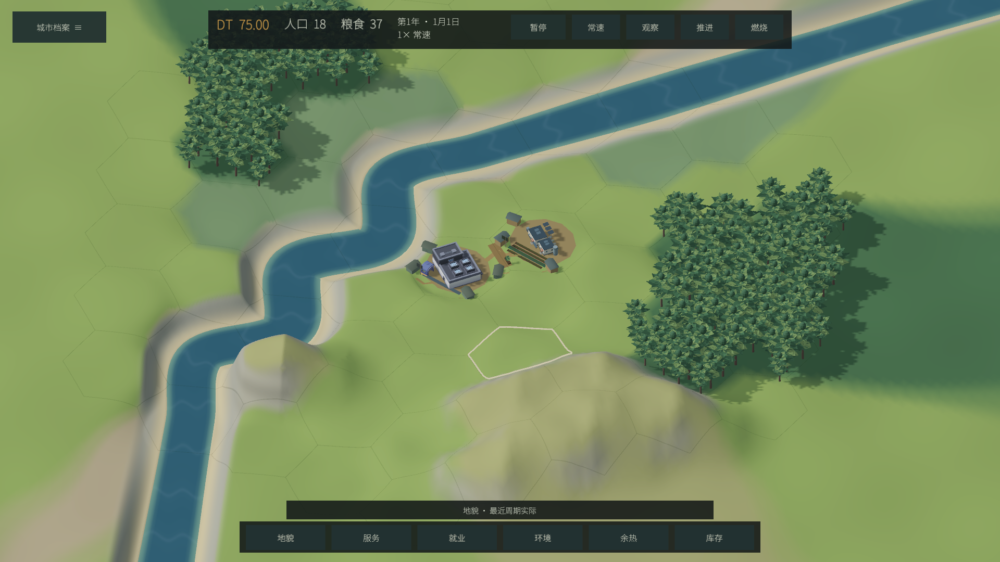

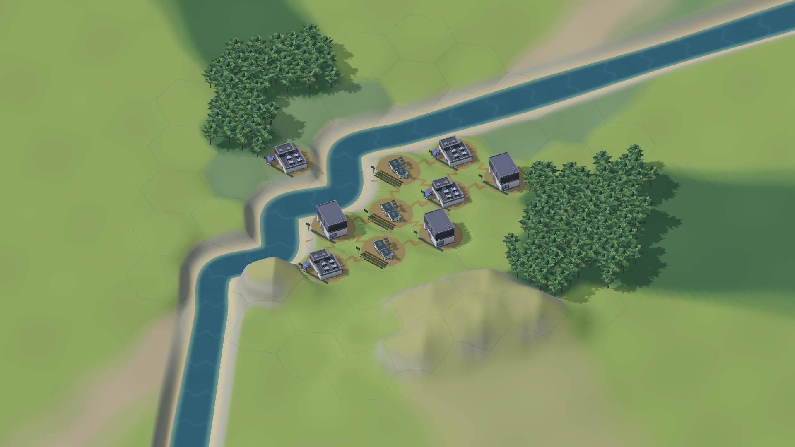

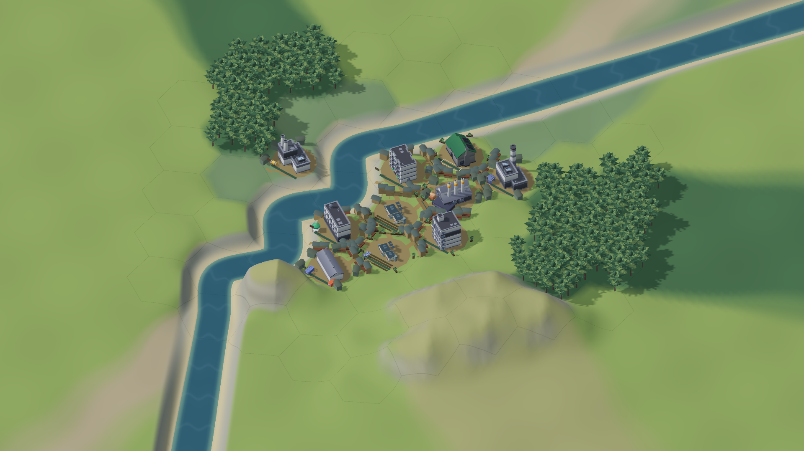

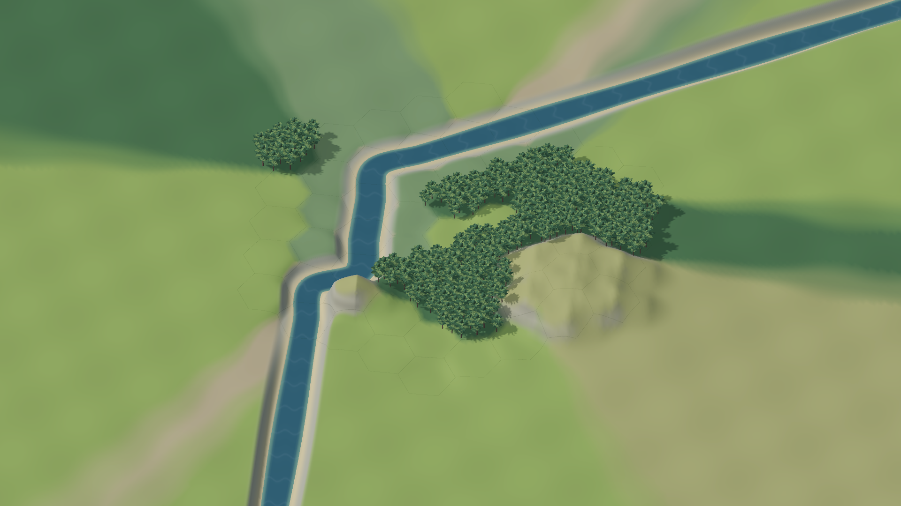

## visual.6 本地候选：参考调研、植被、可读性与内存

2026-10-14，接续已完成的 [City 发展弧](../city_arc/ACCEPTANCE.md)。本次应用版本为 **0.6.0-visual.6-local**，源码仍是 `codex/met-beta-v3` 在 `72aee5b` 上的未提交工作目录，保留上一轮全部功能。当前是本地候选，未推送或发布；**Civ6 质感目标仍未完成**。

### 实际改变

- 检查了本机 Civ6 的地图生成 Lua、地形/杂物/城市/道路美术定义及中文 UI 样式。确认的配置与对 MET 的推断分开记录于 [本机参考报告](CIV6_LOCAL_REFERENCE.md)。没有把其模型、贴图或代码加入 MET，也没有还原它的渲染器或交叉口算法。
- 引入六种免费 Quaternius CC0 自然模型，使用官方 glTFast 导入及共享实例批次；林地跨格生成与开发清林仍由脱离快照确定。新增原创 imagegen 草地和岩面材质，保留生成原图，河岸/坡面按世界位置混合，岩面三向投影。地貌轮廓减少规则波纹，岩块缩放、嵌入地表并与坡面统一材质。[资源、许可和制作边界](NATURE_ASSETS.md)单独记录。
- 树冠使用整体冠形法线、统一低饱和色和连续的冠底明暗，保留原叶片几何及地面树影。中间 visual.4 太暗、visual.5 太平，均经真实截图否定；最终 visual.6 的体积与噪点改善已实看，不把中间图算作最终结果。
- 中文字体由默认 Thin 的变量字体改为静态 Regular 400；正文与按钮加大，面板底色更实、信息颜色更清楚，城市与科研页面分组。UI 比例和字号仍独立；实际通过设置按钮分别验证 120% UI / 150% 字号与 80% UI / 100% 字号，内容可滚动，无挡住主按钮的溢出。
- 暂停且无状态变化时跳过重复自动保存；正常推进继续自动保存，手动保存、失焦和退出仍执行保存。一次 worker 提交只生成一份整城快照，界面按需缓存脱离的整城视图。保存/读档直接通过 Newtonsoft writer/reader 遍历 V，去掉完整 JToken 中间树，格式与数值语义保持。

### 验证与实际占用

Unity **6000.6.5f1 / URP 17.6.0** 实际编译、导入并构建通用 Mac Player。最终包在 **Apple M5 Max / Metal / 1920×1080 / 60 FPS** 上 [210/210 原生检查](evidence/visual-quality/city-native-validation.json)通过，运行错误为零。包含旧有玩法与城市页面、保存回读、地图/预测只读、真实设置按钮以及截图。完整能力链明确复用前轮 Player 实际命令产生的四街区城市；没有把它称为本轮重新自然通关。快速美术预览是另行标记的 22 项启动/截图检查，不替代完整验收。

JSON 验证包含 **196 项完全一致的输出与 62 项解析值/类型/顺序/错误类别检查**；四街区存档序列化分配减少约 69.7%，解析分配减少约 60.9%。这是 [.NET 单线程分配量](evidence/visual-quality/json-allocation-checks.json)，与进程 RSS 分开。改动后的核心 174 项、已有 Godot 夹具 88 个完整状态检查点、治理 42 项及网络 102 项均通过；此处未重新运行 Godot 引擎。Astra 对 JSON、dirty gate、保存屏障、快照独立性和 UI 缓存失效作独立源码审查，未发现剩余实质回归。

下表是各自新启动的 Player、同一份复制的四街区存档。暂停采样 10 秒，常速采样 30 秒，**正常采样没有强制 GC 或卸载资源**。截图/完整测试在其他进程中执行。

| 构建 / 场景 | RSS | 帧间隔中位 / p95 | CPU（一个核心为 100%） |
| --- | ---: | ---: | ---: |
| 第一轮 visual.1 暂停 | 677.78 MiB | 16.67 / 17.01 ms | 34.83% |
| 第一轮 visual.1 常速 | 759.97 MiB | 16.67 / 18.01 ms | 65.07% |
| 最终 visual.6 暂停 | **608.61 MiB** | 16.67 / 17.10 ms | 39.87% |
| 最终 visual.6 常速 | **663.58 MiB** | 16.67 / 17.60 ms | 51.73% |

[最终占用报告](evidence/visual-quality/memory-final.json)、[首轮报告](evidence/visual-quality/memory-first-candidate.json)和[逐轮对照](evidence/visual-quality/memory-comparison.json)保留。中间 visual.3 曾测得暂停 541.89 / 常速 603.86 MiB；最终记录使用上表，不挑选更低的中间数值。原先 878.09 MiB 来自混合完整测试的进程，不作为这里的受控百分比比较基线。以上是短时进程数据，不是 GPU 单项成本或长时间泄漏测试。

最终暂停期间自动保存写入保持 1 次并跳过 2 次，运行后累计写入 7 次，四个街区都实际推进。正常采样结束后的独立诊断中，强制回收后托管存活量约 73.85 MiB；这项操作仅存在于显式测试模式。部分 Texture2D/Font 的 Unity 大小 API 返回零，不能据此声称纹理或字体没有内存成本。暂停不再定时写整城文件，因此崩溃/强杀时离开时长记录可能从较早的保存点起算；正常失焦/退出仍保存 UTC，离开期间没有补模拟。

### 当前观感与本地包

贴图尺度、森林体积、岩坡细节和中文可读性已有具体改善，但山体仍偏单一、地表组合较空、建筑与自然资产的风格尚未完全统一；区域边缘和跨格街巷的美术衔接仍需继续。功能检查通过不代表 Civ6 质感验收通过，用户还没有认可最终观感。真实系统失焦恢复的人工确认也仍未补做。

应用：`build/MET Visual Quality.app`。ZIP：`build/MET-Visual-Quality-0.6.0-visual.6-local-macOS-universal.zip`。归档已实际解压并通过可执行权限、arm64/x86_64 架构与 `codesign --verify --deep --strict` 检查，见[打包记录](evidence/visual-quality/package-check.json)。当前包采用 ad-hoc 签名，没有 Developer ID 或 Apple 公证；Intel 二进制已构建，但本轮只在 Apple Silicon 实机运行。历史 City Arc 本地包和既有发布均保留。

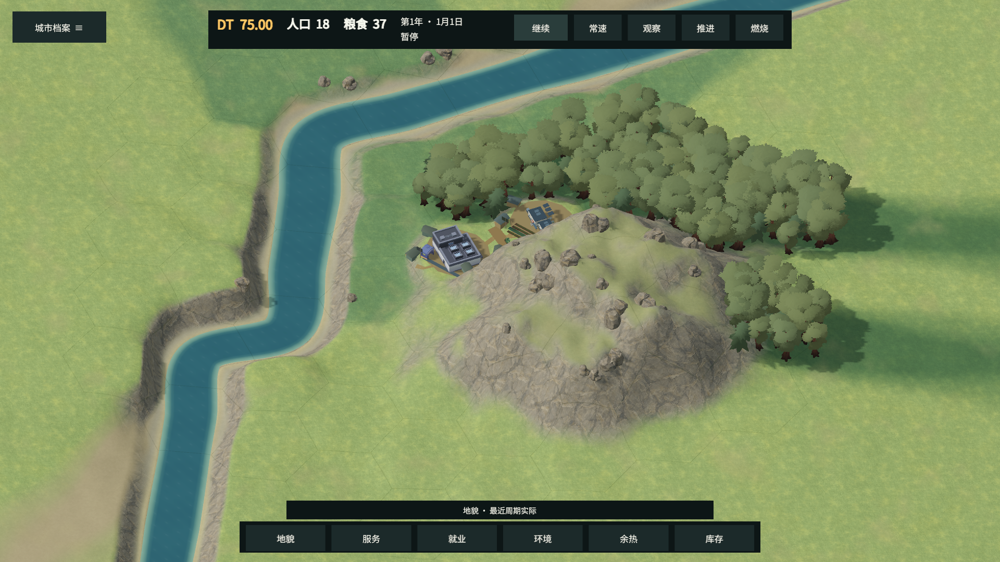

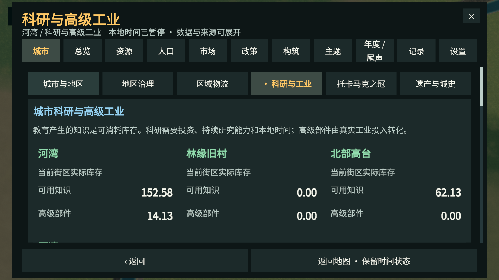

## visual.9 本地候选：中等尺度建筑群与主从关系

2026-10-14，用户看过 visual.8 的 68% 普通主体 / 82% 地标后，要求“稍微放大一点点，不同的建筑群需要突出差异性和主体性”。本次 **0.6.0-visual.9-local** 据此回调为 **74% / 86%**。源码继续是 `codex/met-beta-v3` 在 `72aee5b` 上的未提交工作目录；这是画面目标的继续迭代，**不是 Civ6 质感已经完成的声明**。没有推送、发布或改写模拟规则。

实际改动与观察：

- 保留各蓝图原有主模型，以主体和少量低附楼组织建筑群。住宅短组、产业长仓棚、医疗服务翼、校园留白、农地田垄和轻亭使用不同布局及适度配色；登记用途、运营者、槽位和来源仍可从 UI 读取。
- 道路与主体统一朝向，细弱的外围路径连接较清楚的跨格街道。密集外围小屋圈改为短组与开放院落，成熟街口仍长出少量跨格连廊。成长快照中的主体仍为 10 个真实目录蓝图；中期有 **14 个**带建筑体量的填充节点，后期 **17 个**（含新增 3 个连廊）。后期的 **125 个**填充节点另含 **108 个**开放院落，不能称作 125 栋房屋。附在主体下的低翼楼不包含在这些填充节点数内。
- 相邻丘陵共用山脊方向，降低独立圆包的重复感；树冠和林缘缩小，山体散石同步收小。河岸增加缓坡和内外岸差异。visual.7 的最近河段岸形造成梳齿，visual.8 的分段插值仍有余痕；visual.9 采用世界坐标中的连续弯曲影响场，实机中成排条纹已消退。
- Main 与 Astra 实看同机位开局、后期截图：主体比 visual.8 更醒目，工业/农业/校园区别更清楚；未看到可见近岸主楼浮起、埋入或悬空附属物。仍有相似院落尺寸与方向带来的规则园区感，部分小绿块和连廊在远景只读成短线。上述固定机位观察不代表所有地图位置或最终美术完成。

原生验证：[visual.9 报告](evidence/visual-quality-v9/city-native-validation.json) **210/210 通过，0 errors**，Unity 6000.6.5f1，Apple M5 Max / Metal，1920×1080 全屏。覆盖地图拾取、可见河岸边界、同快照预测恢复、增量节点保留、早中晚成长、实际 uGUI 按钮流程及 UI/字号独立缩放。成长图是显式分离的只读展示快照，不冒充真人游玩的成长时间线。静止渲染采样中位数 / p95 为 **16.67 / 16.67 ms**；功能检查与图片观察分别记录，不用前者代替美术验收。

使用同一份四街区存档副本，重新启动独立 Player，普通测量阶段没有强制 GC 或卸载资源：

| 阶段 | RSS | 中位数 / p95 帧间隔 | 进程 CPU，以一核 100% 为基准 |
| --- | --- | --- | --- |
| 暂停 10 秒 | **553.78 MiB** | **16.67 / 17.15 ms** | **13.52%** |
| 实际常速 30 秒 | **625.66 MiB** | **16.67 / 17.80 ms** | **42.71%** |

[占用原始报告](evidence/visual-quality-v9/memory-final.json)、[保留此前数值的对照](evidence/visual-quality-v9/memory-comparison.json)。暂停期间保存写入保持 1 次、跳过 2 次；常速写入达到 7 次，四街区均实际推进。单次短测不证明长时内存稳定，也不将所有差值归因于某一材质或对象修改；历史 878 MiB 混合测试进程仍不是这里的受控比较基线。强制回收后的诊断值不作为上表正常游戏占用。

构建时曾出现一次 Unity Editor 内部资源回收等待，已结束该批处理；后续使用单资源回收线程完成构建，脚本记录该 Editor 参数，不改变 Player 运行线程。最终通用包已实际解压，验证版本、arm64/x86_64、可执行权限与 `codesign --verify --deep --strict`：[打包记录](evidence/visual-quality-v9/package-check.json)。

当前 app 为 `build/MET Visual Quality.app`，本地 ZIP 为 `build/MET-Visual-Quality-0.6.0-visual.9-local-macOS-universal.zip`（71,379,517 bytes）。签名为 ad-hoc，无 Developer ID / Apple 公证；Intel 二进制未实机运行。app 路径随本地候选更新，旧 visual.6 ZIP 及其历史证据保留。

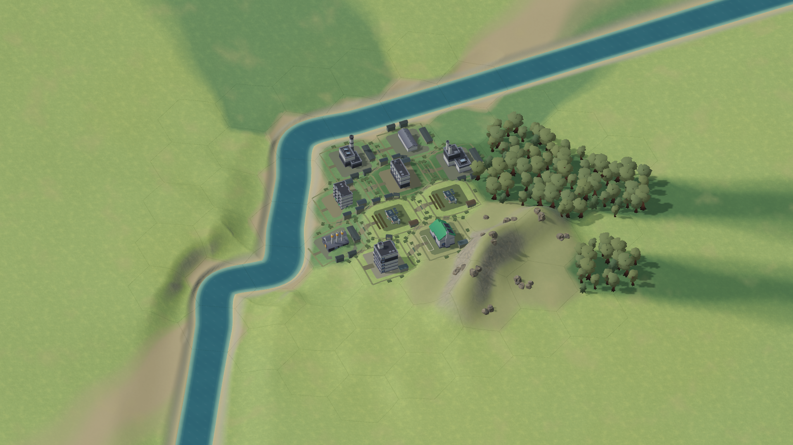

[开局画面](evidence/visual-quality-v9/city-start.png) · [全地图](evidence/visual-quality-v9/city-whole-map.png) · [独立丘陵截图](evidence/visual-quality-v9/city-seeded-hills.png) · [大字号 UI](evidence/visual-quality-v9/city-science-large-type.png)

## visual.12 本地候选：用途庭院、地形层次与道路贴地

2026-10-14，继续保留用户选定的普通主体 **74%**、医院/中学校/发电厂 **86%**。当前版本为 **0.6.0-visual.12-local**，源码仍是 `codex/met-beta-v3` 基于 `72aee5b` 的未提交工作目录。没有推送或发布；美术目标继续进行，不能将这一候选称为 Civ6 质感完成。

- 住宅用小前庭，产业用后场，医疗和校园分别保留入口空地；农业与绿地直接使用地面。原统一大方形地坪取消，外围开放节点不再逐个绘制绿色盒子和细线。主建筑及来源身份、容量和模拟状态不变。
- 各地块只绘制一组入口与必要侧路，真实跨格连接仍是 19 条。邻接门户进入增量签名，新增或拆除邻接会刷新对应道路。早中晚仍是分离的展示快照：晚期 125 个填充节点包括 108 个开放节点和 17 个有屋顶体量的节点，主楼附属翼不算入此数。
- 草地减少大块云状明暗，以会随距离淡出的短纹理补充细节；森林偏绿，坡面岩石偏暖。丘陵保留连续主脊和低肩，较长主脊中段降低形成鞍部；不增加模拟地形类型、纹理文件或缩放时重建。

实际截图发现了两轮道路缺陷：visual.10 的入口重复与尖角产生反向三角；visual.11 修正连接后，仍有道路面内部穿入另一套三角化地形。visual.12 将道路裁分到现有可见地形三角面再抬高，并分开街口和街道的重叠高度。原生检查采样晚期 **9,104 个道路三角面中心**，最小离地 **0.0259997** 世界单位，符合 0.026 的设定。Astra 实际看过最终近景后，未再确认道路缺面；相邻地基之间仍存在较急的高程过渡，画面中有坡道拼片感，这属于尚待改善的形态。

[本轮原生报告](evidence/visual-quality-v12/city-native-validation.json)：**213/213 通过，0 errors**。Unity 6000.6.5f1 / Apple M5 Max / Metal / 1920×1080 全屏。涵盖可见河岸拾取、来源与 RNG 不变、预测恢复、稳定节点保留、成长快照、实际 UI 按钮与独立字号/界面缩放。固定静止渲染样本中位数 / p95 为 16.67 / 16.67ms；这些功能和帧间隔数据不代替美术判断。

独立新 Player 复制同一四街区存档，前台暂停 10 秒后实际常速 30 秒；正常阶段不强制回收或卸载资源：

| 正常阶段 | RSS | 帧间隔中位数 / p95 | CPU，100%=一个核心 |
| --- | ---: | ---: | ---: |
| 暂停 10 秒 | 578.97 MiB | 16.667 / 16.669 ms | 18.31% |
| 常速 30 秒 | 596.41 MiB | 16.669 / 17.621 ms | 47.23% |

[原始占用报告](evidence/visual-quality-v12/memory-final.json)、[保留 v1/v3/v6/v9 的对照](evidence/visual-quality-v12/memory-comparison.json)。暂停保存保持 1 次、跳过 2 次；常速写入 7 次，四街区均推进且存档验证通过。单次短测中暂停 RSS 比 v9 高、常速 RSS 比 v9 低，不能把所有差值归因于此次美术修改，也不证明长时内存稳定。原先 878 MiB 是混合流程进程，仍不是此处的受控基线。强制回收后 RSS 617.94 / 卸载后 620.73 MiB 属于额外诊断，不作为正常游戏占用或“回收收益”。

通用 ZIP **71,381,742 bytes**，已实际解压并验证 arm64/x86_64、版本、可执行权限和深度严格 ad-hoc 签名：[打包记录](evidence/visual-quality-v12/package-check.json)。当前 app 为 `build/MET Visual Quality.app`；本地 ZIP 为 `build/MET-Visual-Quality-0.6.0-visual.12-local-macOS-universal.zip`。Intel 未实机运行，无 Developer ID / Apple 公证；旧 ZIP 与证据保留。

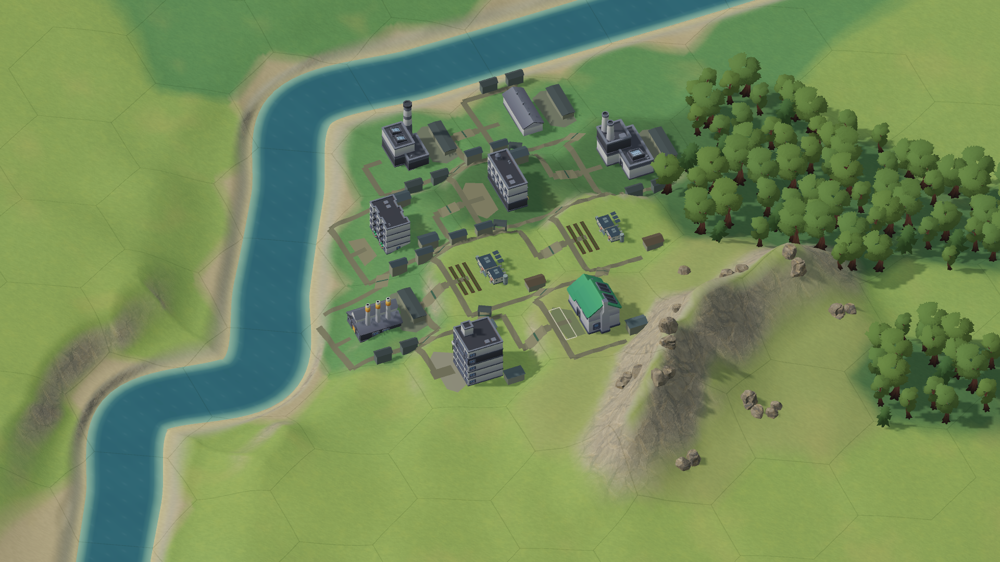

[与 v9 相同机位的总览](evidence/visual-quality-v12/city-growth-late.png) · [开局](evidence/visual-quality-v12/city-start.png) · [独立丘陵](evidence/visual-quality-v12/city-seeded-hills.png) · [大字号 UI](evidence/visual-quality-v12/city-science-large-type.png)

剩余差距：连续山脊仍偏规整，地基与街道高程过渡偏急；原始建筑模型的造型和材质层次仍未达到参考作品。当前用途差异与主从关系已有改善，不能据此把整体画质目标标为完成。

## visual.13 本地候选：墙屋顶分层与相邻地基缓坡

2026-10-14，当前本地版本 **0.6.0-visual.13-local**。保留用户选定的普通主体 **74%**、医院/中学校/发电厂 **86%**，本次没有再缩放主体或增加装饰数量。源码仍为 `codex/met-beta-v3` 基于 `72aee5b` 的未提交工作目录；未推送、发布或改变模拟规则。

- 检查实际 Kenney GLB 的 UV、材质及 512×512 色板后，取消整栋统一去灰。住宅暖墙和陶色屋顶、公共米白墙和灰蓝屋顶、工业暖灰墙和低饱和灰绿屋顶分别处理；玻璃、窗带、设备框架及烟囱标色保留。原 GLB、PNG 与官方 glTFast 导入流程保持，运行时副本共享并在销毁时释放。具体槽位与资源边界见 [社区资产记录](CITY_COMMUNITY_ASSETS.md)。
- 相邻已占用地块共同拟合缓坡，只有主体脚下局部压平，取代每栋独立的圆形平台。地基角落使用连续权重混合，地面高度变化同时进入建筑与院落的增量签名；绘图没有写回模拟高程或 RNG。
- 首次 v13 实图显示内部路面坡折减少，但西岸出现连续陡坎。Main 与 Astra 实看后将临河整平的过渡终点从距岸 0.32 扩到 0.82，再次实际构建与验收。最终图中高岸成为较宽缓坡，道路垂挂感减轻；这个固定机位未见新增明确浮楼或埋楼。最终证据来自 `native-v13-shore`，不是此前未修岸坡的 v13 图。

[最终原生报告](evidence/visual-quality-v13/city-native-validation.json)：**213/213 通过，0 errors**，Unity 6000.6.5f1 / Apple M5 Max / Metal / 1920×1080 全屏。晚期 **9,104** 个道路三角面中心最小离地 **0.0259998**，贴地与拾取仍一致。成长图仍为明确标记的脱离快照：10 个主楼，19 条跨格连接；中期 14 个有体量填充节点，晚期 17 个，晚期另有 108 个开放节点。没有把展示快照称为自然游玩时间线。实际 UI 按钮、独立字号/界面缩放、状态只读、预测恢复与节点保留均继续通过。

材质和地形源冻结后，在全新前台 Player、同一四街区存档副本上测量两次。普通阶段不强制 GC、不卸载资源；两次均确认四街区实际推进，暂停写入保持 1 次并跳过 2 次，常速写入达到 7 次：

| 测量 | 正常阶段 | RSS | 帧间隔中位数 / p95 | CPU，100%=一个核心 |
| --- | --- | ---: | ---: | ---: |
| 首次 | 暂停 10 秒 | 575.83 MiB | 16.667 / 16.819 ms | 26.94% |
| 首次 | 常速 30 秒 | 627.30 MiB | 16.667 / 17.673 ms | 46.04% |
| 独立复测 | 暂停 10 秒 | 566.80 MiB | 16.667 / 16.668 ms | 26.67% |
| 独立复测 | 常速 30 秒 | 635.69 MiB | 16.667 / 17.619 ms | 45.27% |

[首次报告](evidence/visual-quality-v13/memory-final.json)、[复测报告](evidence/visual-quality-v13/memory-repeat.json)、[保留所有已记录候选与两次 v13 的对照](evidence/visual-quality-v13/memory-comparison.json)。本轮常速 RSS 比 v12 单次 596.41 MiB 高约 31–39 MiB，不能宣称这轮继续降低内存。两次活跃托管 heap 为 203.83 / 208.25 MiB，v12 为 181.81 MiB；这些是观察，尚不足以把差值单独归因于色板或某项地形代码。新增色板的最大 GPU 像素规格估算约 6.7 MiB，亦不等于进程 RSS 增量。当前源下 HUD/context 各重建 1 次，terrain build 1 次，Mesh 数仍为 239；没有观察到测量阶段反复构建地形。Texture2D API 对许多纹理返回零，不用其汇总冒充 GPU 显存总量。

正常采样后的额外诊断中，首次强制 GC 后 RSS 626.03 MiB、卸载后 605.95 MiB；复测分别为 635.59 / 609.05 MiB。这些不是正常游戏占用，也没有在产品中添加定期强制回收。历史约 878 MiB 混合流程仍不能与本表作受控百分比比较；两次短测也不构成长时间稳定性证明。

通用 ZIP **71,384,203 bytes**，已实际解压并验证版本、arm64/x86_64、可执行权限和深度严格 ad-hoc 签名：[打包记录](evidence/visual-quality-v13/package-check.json)。当前 app 为 `build/MET Visual Quality.app`，本地 ZIP 为 `build/MET-Visual-Quality-0.6.0-visual.13-local-macOS-universal.zip`。Intel 未实机运行，无 Developer ID / Apple 公证；历史 ZIP 保留。

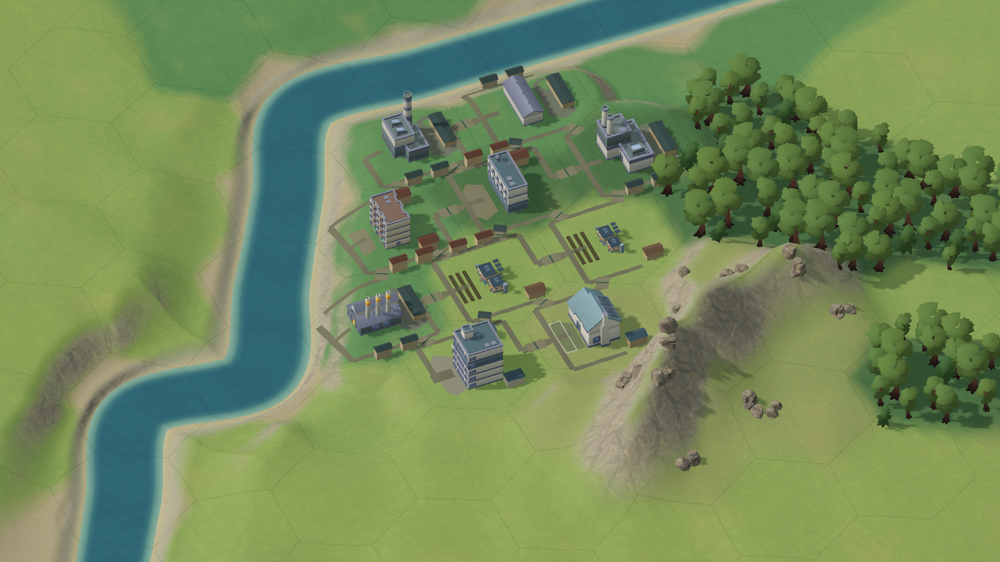

[同机位总览](evidence/visual-quality-v13/city-growth-late.png) · [开局](evidence/visual-quality-v13/city-start.png) · [独立丘陵](evidence/visual-quality-v13/city-seeded-hills.png) · [大字号 UI](evidence/visual-quality-v13/city-science-large-type.png)

本轮材质层次与街间过渡已有可见改善，仍不足以达到 Civ6 的整体质感。剩余主要是建筑几何与规则院落的简陋感、山体和植被的造型层次，以及大面积地表的构图；不能继续把这些差距都归因于贴图分辨率或色板。总体画面目标保持未完成。

## visual.14 本地候选：建筑用途配色

2026-10-14，用户确认当前建筑群“已经不错了”，要求住宅绿、工业黄、服务蓝、特殊建筑红。本轮不继续改已认可的几何、布局或尺度；采用这套颜色作为屋顶和附楼的识别色，并同步建筑详情图标/标题。墙体保留中性米白/暖灰，农业与绿化保留自然色。医院/学校是服务蓝，电力/物流是工业黄；特殊红暂用于已存在的主题定型建筑与托卡马克工程卡片，它们当前没有地图主模型。具体槽位与来源见 [资产记录](CITY_COMMUNITY_ASSETS.md#visual14-类型识别色)。

当前本地版本 **0.6.0-visual.14-local**，仍是既有 `codex/met-beta-v3` 工作目录上的候选，未推送或发布。额外减少静态目录的重复深拷贝，并缓存同一地形下的九点地基签名；地形重建会清除该缓存。没有改模拟规则、实体、RNG 或玩家存档。

[原生报告](evidence/visual-quality-v14/city-native-validation.json)：**213/213 通过、0 errors**，Unity 6000.6.5f1 / Apple M5 Max / Metal / 1920×1080 全屏。实际 UI 回调、预测/实际往返、只读边界、稳定节点、同地形复用及贴地道路检查继续通过。成长图仍是脱离模拟的固定展示快照，未冒充自然游玩成长时间线。Main 查看实际近景和工程页后，确认住宅绿、服务蓝、制造与货运黄可辨；红色工程标题实际显示。 Astra 独立检查早/中/晚三张实图及缓存失效链，未发现本轮配色或性能缓存改动的实质阻塞项；没有将红色地图模型列为已验收。

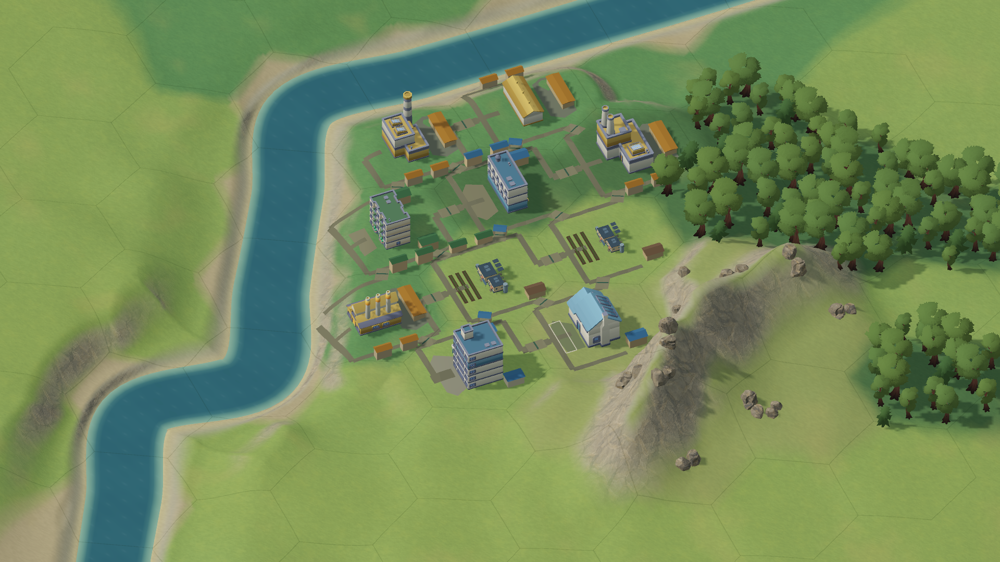

[早期社区配色](evidence/visual-quality-v14/city-growth-early.png) · [中期住宅与服务](evidence/visual-quality-v14/city-growth-middle.png) · [同机位总览](evidence/visual-quality-v14/city-growth-late.png) · [特殊工程红色标题](evidence/visual-quality-v14/city-arc-tokamak.png) · [大字号界面](evidence/visual-quality-v14/city-science-large-type.png)

新进程加载与 v13 相同的四街区存档副本，前台正常阶段不强制回收、不卸载资产：

| 正常阶段 | RSS | 帧间隔中位数 / p95 | CPU，100%=一个核心 |
| --- | ---: | ---: | ---: |
| 暂停 10 秒 | 592.30 MiB | 16.667 / 16.750 ms | 30.41% |
| 常速 30 秒 | 647.19 MiB | 16.668 / 17.631 ms | 47.14% |

[原始短测](evidence/visual-quality-v14/memory-final.json)、[保留所有既有测量的对照](evidence/visual-quality-v14/memory-comparison.json)。四街区实际推进且验证通过；暂停保存 1 次、跳过 2 次，常速保存共 7 次。HUD/context 各构建 1 次、terrain build 1 次，Mesh 239、Texture2D 86、RenderTexture 6、Material 156。常速托管使用 91.18 MiB、heap 205.03 MiB。RSS 高于 v13 两次短测，不能宣称缓存调整带来进程占用下降，亦未单独证明差值来源。额外诊断强制 GC 后 649.80 MiB、卸载后 652.62 MiB 不代表正常占用改善。短测不证明长期稳定；原 878 MiB 混合流程不是受控同条件基线。

完整回归的混合流程末段 [300 帧记录](evidence/visual-quality-v14/city-arc-active-performance.json) 为中位 16.667 / p95 19.368 ms、RSS 779.78 MiB，必须与上述干净进程的正常短测区分。默认仍限帧 60。

通用 ZIP **71,384,738 bytes**，实际解压后版本、arm64/x86_64、可执行权限和深度严格 ad-hoc 签名检查通过：[打包记录](evidence/visual-quality-v14/package-check.json)。当前 app：`build/MET Visual Quality.app`；本地 ZIP：`build/MET-Visual-Quality-0.6.0-visual.14-local-macOS-universal.zip`。Intel 未实机运行，无 Developer ID / Apple 公证；旧版本 ZIP 保留。

用户对当前形态的认可作为本轮视觉方向的接受依据；这不等于证明所有美术已与 Civ6 等质。当前交付重点是清楚的用途识别和已认可的建筑群，后续按新反馈继续迭代。

## visual.16 本地候选：闭合环路与六方向出口

2026-10-14，当前本地版本 **0.6.0-visual.16-local**。本轮接续用户要求的更广用途配色、自然坡面、多种地表/道路与元素避让；用户随后指定先做“每栋建筑下环形路，按相邻六边方向引出连接”的简单版本，因而用闭合圆角环路替代中途 v15 的单纯入口树。普通主体 74%、医院/中学校/发电厂 86% 保持。源码仍为既有 `codex/met-beta-v3` 基于 `72aee5b` 的未提交目录；本轮没有推送或发布，旧 ZIP 保留。

- 每栋完工主楼有一个完整的圆角脚印环路，六个邻格方向的射线决定出口。活跃跨格道路与环路复用同一世界坐标端点，通过对应共享边中点；入口和附楼以短支路接入。成熟度/邻接不再单独决定修路：只显示已有就业、服务、物资联系较紧的相邻对。本次晚期展示的 **19 对相邻候选中绘制 6 条连接、10 个闭环**。
- 取消邻域整平，地形高度与碰撞始终使用天然生成表面。陡坡主楼在原格内寻找较平缓位置，脚下使用局部挡墙/台阶；翼楼与附房各自落地。实际生成山地 fixture 的 **305 个高度采样最大变化为 0**，地面和格子碰撞对象保持，7 个坡面支撑、24/24 个接入终端可达。陡坡样例的最大主楼脚印高差从中途 v15 的 1.2017 降到 **0.6255** 世界单位；仍有可见挡墙，不代表完成复杂山地建筑设计。
- 建筑墙面和附属体量扩大住宅绿、工业黄、服务蓝的覆盖；独特地标及托卡马克工程保持特殊红，医院/学校/电厂按用途。高级普通建筑不因 tier 自动变红。四种地表风格为草甸、林地落叶、干草土与既有岩面，三种道路为土路、铺石、碎石。六张新增 512 原创参数化贴图及三平面道路投影见 [资产来源](NATURE_ASSETS.md#visual15-natural-slopes-same-cell-occupancy-and-surface-families)。中途大暗斑与过白道路实图已被收敛，未复制 Civ6 资源。
- 同格空地选择同时避主楼/翼楼、真实环路和出口、农田与附房；自然物先保留安全原位，再搬动冲突实例，找不到适合空地的装饰才省略。院落禁止自然物而允许通行。田块收拢到环路外侧，保持三行作物；实际地面网格顶点验证了早/中/晚/山地田块均在其来源格内。山地样例有 7 个同格移位实例，占用重叠与跨源格实例计数均为 0；56 个请求因无合适空间省略，未声称所有装饰均可保留。

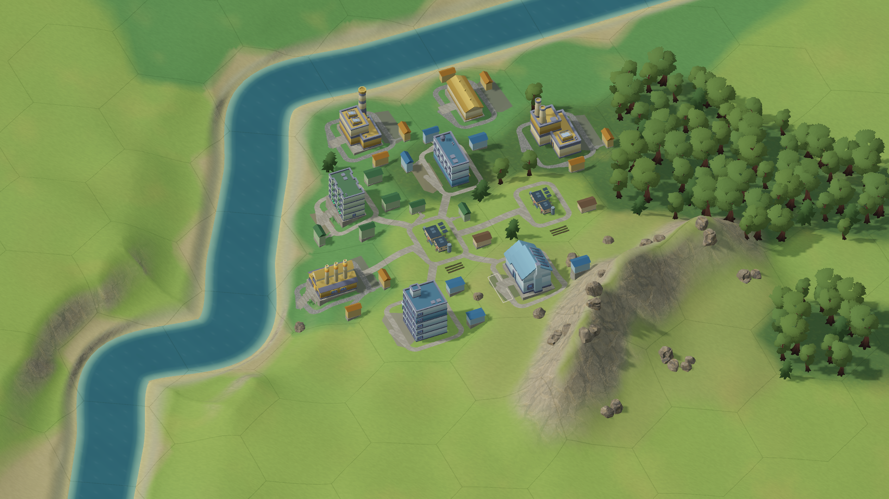

[同机位总览](evidence/visual-quality-v16/city-growth-late.png) · [早期闭环](evidence/visual-quality-v16/city-growth-early.png) · [天然山地上的建筑与环路](evidence/visual-quality-v16/city-hillside-buildings.png) · [实际 UI](evidence/visual-quality-v16/city-native-final.png)

[最终原生报告](evidence/visual-quality-v16/city-native-validation.json)：**241/241 通过、0 errors**，Unity 6000.6.5f1 / Apple M5 Max / Metal / 1920×1080 全屏。三阶段及山地闭环数量正确，环路越格、湿岸、穿主楼与共享出口不一致计数均为 0；接入可达、实际/预测恢复、同快照零场景工作、UI/字号和来源/RNG 不变检查继续通过。成长和山地画面是标记清楚的脱离快照，建筑位置/占用被注入以展示形态，没有冒充自然游玩的时间线。

实机发现并修复过两类入口问题：旧固定出口与岸线判定不一致、迁移附楼虽不重叠却处于翼楼死角。另修复田块挂建筑父节点后世界顶点重复平移的问题；最后的四个田块检测检查实际网格顶点（1,052 / 472 / 472 / 2,649 个），均未越来源格。前段 Astra 源码审查帮助定位终端被圆角绕开和门口占用问题；最终环路复审遭遇 Astra 容量限制，未完成。本轮最终环路由 Main 检查源码与实际截图，并完成上述原生验证，未把失败的独立审查标为通过。

旧验收 Player 曾在失焦后停止截图/退出，导致测试悬挂；验收/占用模式现在允许后台继续上报，产品时钟的失焦暂停规则仍保持。实际常速性能段必须全程前台，最终记录通过该检查；普通产品启动没有启用这个测试模式。

同一四街区存档副本在新前台 Player 上进行正常短测，未在普通阶段强制回收或卸载资源：

| 正常阶段 | RSS | 帧间隔中位数 / p95 | CPU，100%=一个核心 |
| --- | ---: | ---: | ---: |
| 暂停 10 秒 | 590.28 MiB | 16.667 / 17.151 ms | 32.46% |
| 常速 30 秒 | 615.34 MiB | 16.667 / 17.629 ms | 49.75% |

[原始短测](evidence/visual-quality-v16/memory-final.json)、[保留历史版本的对照](evidence/visual-quality-v16/memory-comparison.json)。四街区均实际推进且验证通过；暂停自动保存 1 次、跳过 2 次，常速共 7 次。HUD/context 各构建 1 次、terrain build 1 次，Mesh 221、Texture2D 91、RenderTexture 6、Material 158；常速托管使用 152.18 MiB、heap 178.94 MiB。RSS 低于 v14 单次 647.19 MiB，CPU 略高，不能单凭一次短测将差值归因于环路或贴图，也不证明长时间稳定。额外强制 GC / 卸载后的 633.64 / 636.44 MiB 只作为诊断。完整回归混合流程末段 [300 帧](evidence/visual-quality-v16/city-arc-active-performance.json) 为中位 16.668 / p95 19.253 ms、RSS 818.72 MiB，不能冒充上述干净进程占用。

通用 ZIP **72,097,127 bytes**，已实际解压并检查版本、arm64/x86_64、可执行权限与深度严格 ad-hoc 签名：[打包记录](evidence/visual-quality-v16/package-check.json)。本地 app 为 `build/MET Visual Quality.app`，ZIP 为 `build/MET-Visual-Quality-0.6.0-visual.16-local-macOS-universal.zip`。Intel 未实机运行，未做 Developer ID / Apple 公证。当前是用户指定的环路简单版本：尚无交通、车道/复杂路口或完整山地建筑体系，整体美术目标仍需后续视觉反馈。

## 本地内容 content.1

2026-10-14 已从视觉收口转向内容：新增方案、分支议案、首次实际 DT0 的贡献锁定及付费同城规约，完成新专项、两条实际命令链和 Mac 内容 UI 回调验收。详见 [content.1 验收](../rogue_content/ACCEPTANCE.md)。旧视觉证据保留历史范围，不作为新内容或性能验收。
