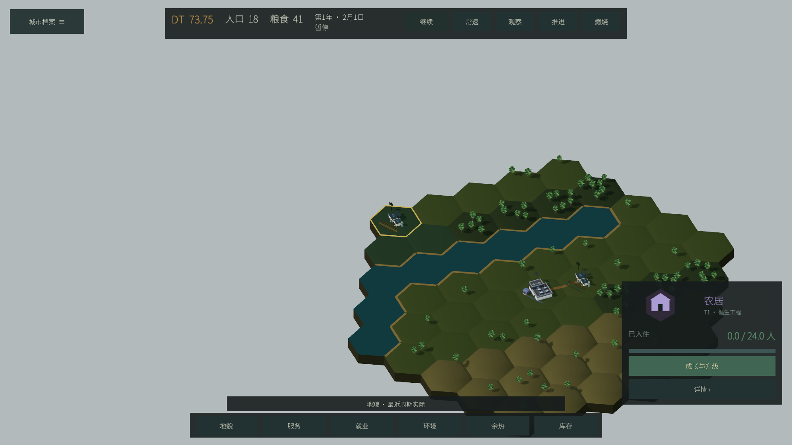
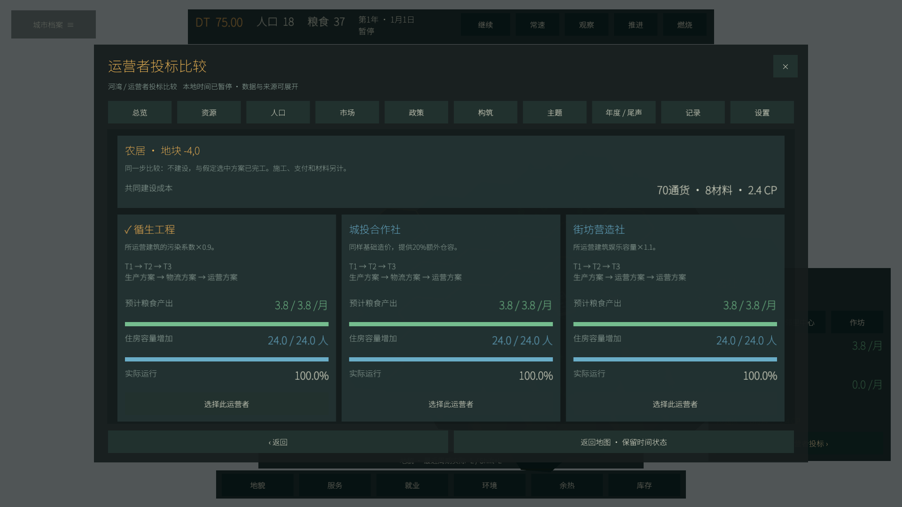
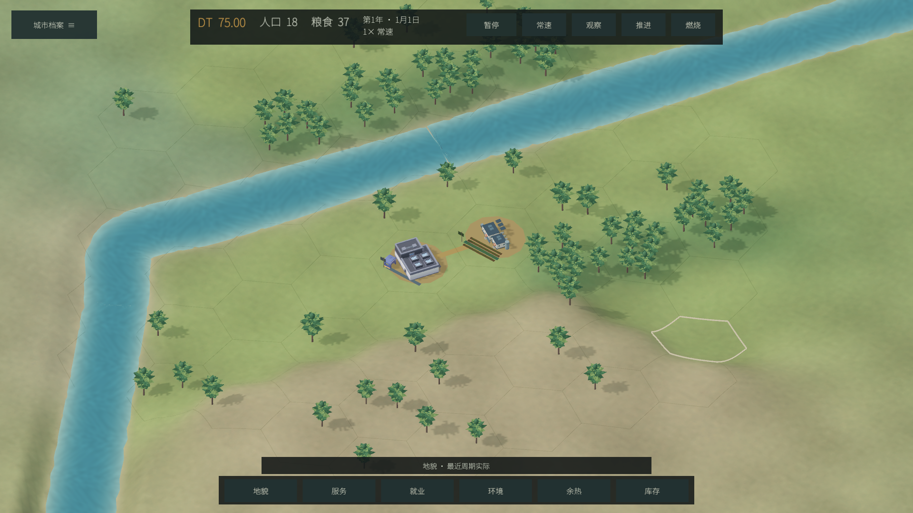
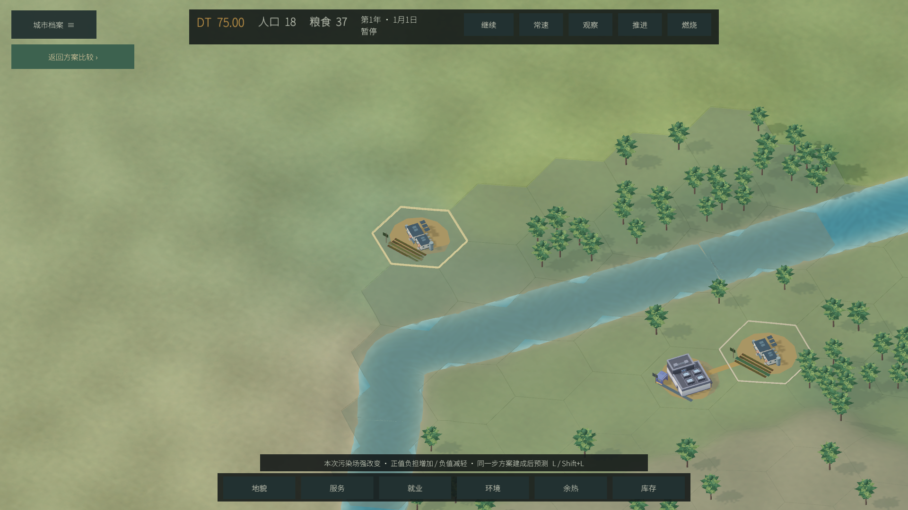
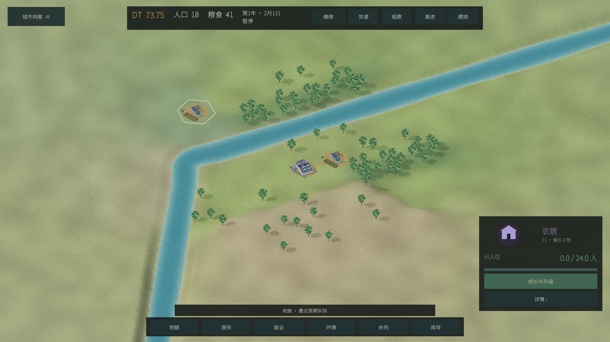

# 完整 Unity 迁移

**2026-10-13 用户实看后反馈首版画面丑且占用高，`unity.1` 没有发布。** 已完成 `unity.2` 的限帧、UI 复用、连续河谷和透明分析图层修复，实际结果见本页末尾。功能检查不代表玩家认可画面，也不代表已达到 Civ6 的成熟美术。

用户在 2026-10-13 授权迁移现有 MET Beta 游戏，选择 Unity 6.6（6000.6.5f1），并明确 Godot / Unity 存档无需兼容。迁移继续同一套玩法和内容，不以河谷展示替代完整游戏。原 Godot 入口保留，原 Hero 切片文档和证据保留历史含义。

Unity 工程仍位于 `unity/METLivingWorld`。依赖为官方 URP 17.6、uGUI 2.6、glTFast 6.20.0、Newtonsoft JSON 3.2.1，以及 MIT 的免费 XCharts 3.15.0。具体补丁版本以实际 Editor 包解析记录为准；不使用 XCharts Pro。

## 实现边界

- `Assets/MetCore` 是原生 C# 城市核心：JSON 值、确定性 RNG、空间规则与分配、人口、生产、建设升级、市场、Bonus、主题、年度与 DT 尾声。它不引用 UnityEngine，不运行 GDScript。
- `Assets/City/Runtime` 拥有真实活跃时间、游戏命令与 Unity 独立存档。界面只在命令提交处接触真实 Game；画面读取脱离状态。
- `Assets/City/UI` 使用官方 uGUI 控件，保留 L0–L3、三个起源、完整管理、来源、同一步建设比较与独立 UI 比例。
- `Assets/City/World` 读取动态城市快照，呈现完整 61 格地图、建筑、植被和来源分析。21 个定义绑定 19 种主模型，18 种主模型来自 Kenney CC0 社区套件；医院/学校采用通用楼体加用途设施，农业三类共享原农居主模型。资源与复用边界见[社区资产记录](CITY_COMMUNITY_ASSETS.md)，这仍是首版美术。
- `StreamingAssets/MetContent` 来自当前 Godot 内容文件；`tools/sync_unity_content.py` 同步并逐字节核对。中文字体为原有 OFL Noto Sans SC，音效为原项目音效。

原有有限 DT、离线只记录时长、Local Time 移民、真实活跃货运、重复副本、升级与主题规则保留。Unity 保存 `met_unity_v1.json` 和独立城市记录，不导入 Godot 存档。默认桌面全屏 1920×1080；本轮不增加移动端或不同窗口尺寸验收。

## 当前实际证据

在 Apple Silicon macOS 上，Microsoft .NET SDK 10.0.401 实际编译核心至 netstandard2.1 / C# 9，零错误。17 项基础、30 项规则与模拟、127 项成长与主题检查，共 **174/174** 通过。

Godot 4.7.2 和 C# 运行同一组命令，共 **88 个完整状态检查点** 一致：三个正常起点 62 个，加一个明确标注注入前置条件的复合机制 fixture 26 个。复合链路实际完成重复 P07 部署、agriculture 升级、两次蓝图研究、L05 仓容与市场双向成交，并保持重载后的完整状态/RNG。数值使用相对容差 1e-9，RNG、队列、数组顺序、字符串和状态字段逐项比较。导出器为 `tools/export_unity_core_parity.gd`，C# 入口为 `tools/unity_core/CoreProgram.cs`。这些是核心对照，不是自然通关或完整 Unity 原生玩法验收。

Astra 已独立审查迁移核心，确认的宿主时间与决策差异由 Runtime 修正。Unity 6000.6.5f1 已实际编译核心/UI，解析官方依赖、通过官方 glTFast 导入登记 GLB，并生成完整场景。实际 Player 结果见以下两轮记录；真实系统失焦恢复的人工确认尚未进行，用户当前不方便测试。旧 Hero / Godot 截图不作为本轮 Unity 结果。

核心结果的可追踪摘要见 [full-core-validation.json](evidence/full-core-validation.json)。完整状态夹具由脚本重生成，避免把测试城市当成正式存档。

## 首版 Unity / macOS 执行，未发布

Unity 6000.6.5f1 已实际解析 URP 17.6.0、uGUI 2.6.0、glTFast 6.20.0、Newtonsoft JSON 3.2.1，导入全部 34 个登记 GLB，并构建 macOS Intel/Apple Silicon 通用应用。应用版本为 `0.5.0-beta.2-unity.1`，bundle 为 `com.projectmet.laisheng.unitybeta`。

在本机 Apple M5 Max / Metal、1920×1080 渲染基线下，最终已签名 Player 的 **80/80 原生自动检查**通过，零运行错误。实际经过登陆/起源控件、十页管理、页面只读、关闭保持暂停、独立 UI 比例、六图层、同一步建设预测/返回/差值清理、真实招标建设与完工、历史页面和截图。结果见[原生 JSON](evidence/full-migration/city-native-validation.json)。控件测试调用真实 uGUI callback，不把它称为鼠标命中验收。

用户实际长按“在此登陆”约半秒后放开，确认进入起源选择；最终包另以真实键盘确认登陆、确认起源进入 play，P 暂停。初次键盘实测发现遮罩背后 HUD 抢焦点，修正为模态 CanvasGroup 与页内焦点独占后，复测成立；记录见[输入证据](evidence/native-input-checks.json)。

暂停的三建筑场景采样 120 个 renderer 帧间隔，中位约 0.39ms、p95 约 1.14ms；另一次真实推进一个来生月的完整模拟 CPU 约 68ms。两者分别测量，不是 GPU 单项耗时，也不是成熟大城性能验收；Intel 硬件和 Windows 尚未实机测试。

应用内四个 SDK 动态库原签名要求导致嵌套校验失败，重新生成独立 ad-hoc 要求并从内到外签名后，`codesign --verify --deep --strict`通过。没有 Developer ID 签名或 Apple 公证。

## unity.2 画面与占用修复

默认与旧 `frame_limit=0`（自动）均按 60 FPS 执行，设置页保留 30 / 60 / 120。L1/L2 按实际可见内容变化重建，指针查询复用，折叠内容首次展开才生成；关闭档案释放页面与预测引用。关闭预测并返回地图时，同一选择的 L2 恢复，World 与 UI 选中地格保持一致，预测状态拒绝真实选择入口。

连续地表用一张实际可见网格替代独立六角底座和重叠背景。61 格碰撞与分析面裁切同一地表三角形，消除岸边/丘陵分析孔洞；格线与选择线沿曲面细分。共享低分辨率地貌颜色和 CC0 草土细节纹理、河面深浅流纹使用实时日光与独立 FullCity 环境；历史 Hero 资源未改。建筑/附属模型按需加载，开局实际加载 4 个 prefab。开局镜头靠近聚落，Home 看全城，地图比例与 UI 比例独立。

最终通用应用 `0.5.0-beta.2-unity.2` 在 **Apple M5 Max / Metal、1920×1080** 下 **88/88 原生检查通过**，零运行错误，包含真实 World 选择请求的预测拒绝与返回同步、L2 恢复、序列化透明材质及截图。旧“自动”显示设置实测仍按 60 帧启动。结果见 [本轮原生 JSON](evidence/visual-fix/city-native-validation.json)。

前台暂停三建筑场景采样 300 帧、约 5.05 秒：帧间隔中位 **16.67ms**、p95 **17.16ms**；进程 CPU **29.87%（单核计法）**、RSS **409.77MiB**。静止时状态/L2重建及预测计算均为 0，规划缓存为 0。这验证了限帧和重复工作的修复，不能称为 GPU 单项成本或成熟大城性能；内存没有大幅下降。首版 CPU 未按同一前台采样，不能据此声称 CPU 百分比下降多少。

一次截图采集被外部窗口焦点改变为非基线尺寸，分辨率断言失败，该次作废。最终用显式全屏启动参数复测，所有七张截图均为 1920×1080。通用二进制与从内到外 ad-hoc 签名再次验证；没有 Developer ID 或 Apple 公证。首版不会上传，本轮作为迁移测试版交付，不称为 Civ6 画面完成。

